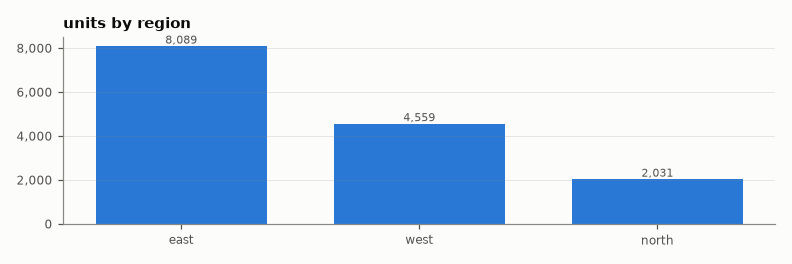
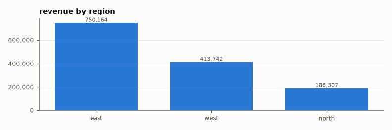
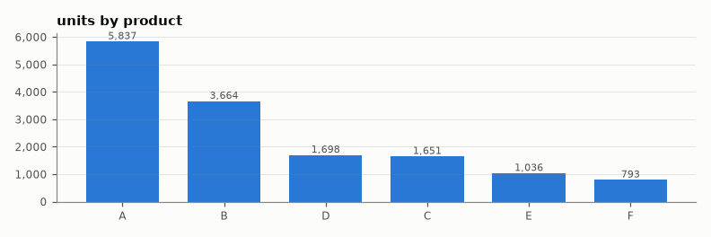
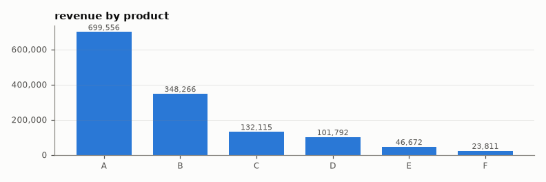

# Data report — business_demo
*2026-07-29 · 1276 rows · 5 columns · engine time 1s*

## The headlines

- units is rising (about 3.64 across the record) — SOLID
- ↳ if the pace holds, roughly 0.9112 more over the next quarter of a record this length — extrapolation, plainly labeled
- units and revenue move together (r=+0.80) — SOLID
- ↳ useful for sanity-checking a forecast of one from the other; it does not say which causes which
- units peaks on Tue, dips Sat (day of the week) — SOLID
- ↳ worth checking what differs about Sat — hours, staffing, promotion; a repeatable dip is repeatable money
- revenue peaks on Wed, dips Sat (day of the week) — SOLID
- ↳ worth checking what differs about Sat — hours, staffing, promotion; a repeatable dip is repeatable money
- 'A' leads revenue by product (52% of total) — SOLID
- ↳ if margins are similar, 'A' is where the volume lives — the 'B' gap is the growth question to ask
- 'A' leads units by product (40% of total) — SOLID
- ↳ if margins are similar, 'A' is where the volume lives — the 'B' gap is the growth question to ask
- 'east' leads revenue by region (55% of total) — SOLID
- ↳ if margins are similar, 'east' is where the volume lives — the 'west' gap is the growth question to ask


## The analyst's note *(every figure verified against the receipts)*

The business is healthy and concentrated: 'east' delivers 55% of revenue and product 'A' alone is 52% of the total. Units are rising steadily, and the weekend dip is the clearest fixable pattern in the file - Saturday runs far below the weekday pace. If margins are even roughly similar across regions, the growth question is why 'west' trails.


## Column by column (plain English)

- **units** — found a repeating cycle (period 409.9874 (shape refused past the null)); no law-grade trend certified. what's there: rising +3.175 per unit date (about +3.645 across the whole record) — SOLID: direction held in 100% of 200 random half-samples, in both the early and late halves; half-sample spread [+2.229, +3.981] per unit date
- **revenue** — no law-grade rule certified. what's there: rising +274.7 per unit date (about +315.3 across the whole record) — WEAK: direction held in 100% of 200 random half-samples, NOT in both the early and late halves; half-sample spread [+166.6, +366.8] per unit date

> Two kinds of claims above, kept honest: a **certified rule** passed our strictest checks; a **what's-there** description reports the plain trend graded by whether it survives 200 random half-samples (SOLID / WEAK / UNSTABLE) — described, never certified. Every claim traces to a receipt at the bottom; where we can't stand behind a number at all, we say so instead of guessing.

## What is in this data

- **date** (dates): 2025-01-01 to 2026-02-24, 1276 entries
- **region** (category): 3 groups; most common 'east' (574 of 1276 rows)
- **product** (category): 6 groups; most common 'A' (506 of 1276 rows)
- **units** (number): 1276 values, 2 to 28, typical 10, mean 11.5, total 14,679
- **revenue** (number): 1276 values, 89.1 to 3,273, typical 944, mean 1,060, total 1.35M

## Month over month (period facts, exact)

- **units**: 2026-01 total 1,066, -14.2% vs 2025-12 (1,243); +13.9% vs the same month last year (936). The file's final month is part-way through and was left out of this comparison
- **revenue**: 2026-01 total 100,390, -13.8% vs 2025-12 (116,418); +16.3% vs the same month last year (86,348). The file's final month is part-way through and was left out of this comparison
- **units movers by region** (2025-12 → 2026-01): held up best 'north' (-17.9%, -29); biggest faller 'west' (-20.0%, -105)

## How the groups compare

- **units by region** — leader 'east' with 55% of the total, ahead of 'west' — SOLID (led in 100% of 200 random half-samples). Top groups: 'east' 8,089 (55%, 574 rows, avg 14.1); 'west' 4,559 (31%, 453 rows, avg 10.1); 'north' 2,031 (14%, 249 rows, avg 8.16).

- **revenue by region** — leader 'east' with 55% of the total, ahead of 'west' — SOLID (led in 100% of 200 random half-samples). Top groups: 'east' 750,164 (55%, 574 rows, avg 1,307); 'west' 413,742 (31%, 453 rows, avg 913); 'north' 188,307 (14%, 249 rows, avg 756).


- **units by product** — leader 'A' with 40% of the total, ahead of 'B' — SOLID (led in 100% of 200 random half-samples). Top groups: 'A' 5,837 (40%, 506 rows, avg 11.5); 'B' 3,664 (25%, 323 rows, avg 11.3); 'D' 1,698 (12%, 138 rows, avg 12.3).

- **revenue by product** — leader 'A' with 52% of the total, ahead of 'B' — SOLID (led in 100% of 200 random half-samples). Top groups: 'A' 699,556 (52%, 506 rows, avg 1,383); 'B' 348,266 (26%, 323 rows, avg 1,078); 'C' 132,115 (10%, 153 rows, avg 863).


## What repeats

- **units by day of the week** — peak Tue (avg 13.9), trough Sat (avg 6.85), swing 7.04 — SOLID (pattern found on one random half confirmed on the unseen half in 100% of 200 tests)
- **units by month of the year** — peak Oct (avg 13.2), trough May (avg 10.1), swing 3.12 — WEAK (pattern found on one random half confirmed on the unseen half in 98% of 200 tests)
- **revenue by day of the week** — peak Wed (avg 1,257), trough Sat (avg 628), swing 629 — SOLID (pattern found on one random half confirmed on the unseen half in 100% of 200 tests)
- **revenue by month of the year** — peak Sep (avg 1,259), trough Mar (avg 914), swing 345 — WEAK (pattern found on one random half confirmed on the unseen half in 92% of 200 tests)

## What moves together

- **units and revenue** move together (r=+0.80) — SOLID (sign held in 100% of half-samples, spread [+0.78, +0.83]). Link, not cause — we can't say which drives which from this table alone.

## Where the weight sits

- **units**: top 20% of rows carry 35% of the total — fairly evenly spread.
- **revenue**: top 20% of rows carry 39% of the total — fairly evenly spread.


## The receipts — analyst face (verbatim)

```
THE ANALYST'S REPORT — business_demo.normalized.csv
  1276 rows; time key: date (told — duplicate timestamps present (step read from median spacing))
    date: 2025.00137 .. 2026.149315
    units: 2.0 .. 28.0
    revenue: 89.1 .. 3272.9
  ── units ──
    trend [NO RULE]: NO RULE (nothing beat the null)
    cycle: period 409.9874 (shape refused past the null)
    the books: trend 0.0% + seasonal 0.0% + residual 100.0% = 100
    receipt: profile: explains -0.00 <= null 0.00 — period said, shape refused
    receipt: trend: NO RULE — flat (mean) stands, said
    forecast next 12: 0.0 .. 0.0 (last seen 26.0)
    watch: BASELINE (err_norm 1.0) — arriving data will be judged
  ── revenue ──
    trend [NO RULE]: NO RULE (nothing beat the null)
    the books: trend 0.0% + seasonal 0.0% + residual 100.0% = 100
    receipt: period: best autocorr 0.10 <= null 0.12 — no cycle said
    receipt: trend: NO RULE — flat (mean) stands, said
    forecast next 12: 0.0 .. 0.0 (last seen 1164.72)
    watch: BASELINE (err_norm 1.0) — arriving data will be judged
  ── relations ──
    units ~ revenue: RELATED corr 0.318 vs null 0.089 (same-step); levels 0.46 — levels co-move trivially under shared trends — reported, never judged
  ── the dossier (node dossier:business_demo.normalized) ──
    units: n 1276, mean 11.5039, median 10, std 5.45664
      mode 8 (x109); resolution 1; lo 2 / hi 28 (rows kept)
    revenue: n 1276, mean 1059.73, median 943.745, std 616.565
      mode 180.36 (x2, 2 tied); resolution 0.01; lo 89.1 / hi 3272.9 (rows kept)
    examples: 16 rows remembered of 1276 (extremes + even spread by outcome rank (the facts-layer sampler, reused))
    frames/year: 2 buckets; revenue avg 1045.98 (2025) -> 1155.63 (2026)
    frames/month: 14 buckets; revenue avg 948.883 (2025-01) -> 1207.3 (2026-02); slope 275.322/yr (described, not judged)
    frames/day: 420 buckets; revenue avg 1296.19 (2025-06-30) -> 1041.24 (2026-02-24); slope 190.673/yr (described, not judged)
    ratio units/revenue: mean 0.0125269 (0.0081729 .. 0.0340085)
```