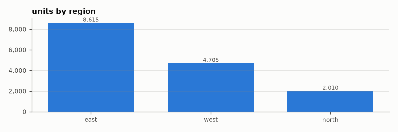
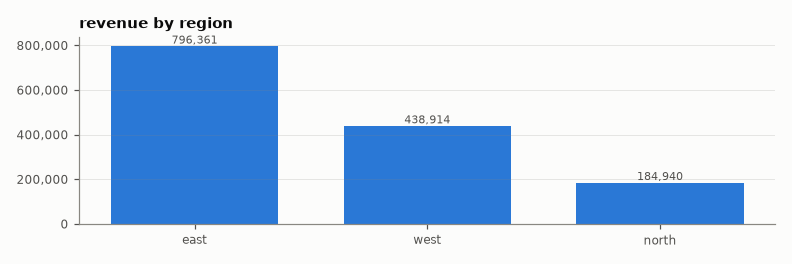
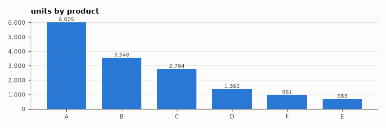
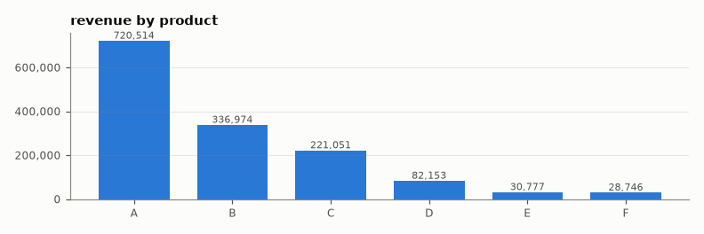

# Data report — business_demo2
*2026-07-29 · 1290 rows · 6 columns · engine time 2s*

## The headlines

- revenue is rising (about 311 across the record) — SOLID
- ↳ if the pace holds, roughly 77.7 more over the next quarter of a record this length — extrapolation, plainly labeled
- units is rising (about 3.99 across the record) — SOLID
- ↳ if the pace holds, roughly 0.9975 more over the next quarter of a record this length — extrapolation, plainly labeled
- the June promotion: units ran +65.3% vs the weekday-matched baseline — SOLID
- ↳ that is the measured effect, seasonality respected — worth repeating if the margin covered the cost
- the June promotion: revenue ran +59.8% vs the weekday-matched baseline — SOLID
- ↳ that is the measured effect, seasonality respected — worth repeating if the margin covered the cost
- units and revenue move together (r=+0.82) — SOLID
- ↳ useful for sanity-checking a forecast of one from the other; it does not say which causes which
- the top 20% of customers carry 69% of revenue
- ↳ these are the relationships to protect — a single defection up there outweighs dozens below
- revenue peaks on Wed, dips Sat (day of the week) — SOLID
- ↳ worth checking what differs about Sat — hours, staffing, promotion; a repeatable dip is repeatable money


## Column by column (plain English)

- **units** — no law-grade rule certified. what's there: rising +3.476 per unit date (about +3.99 across the whole record) — SOLID: direction held in 100% of 200 random half-samples, in both the early and late halves; half-sample spread [+2.674, +4.33] per unit date
- **revenue** — no law-grade rule certified. what's there: rising +270.8 per unit date (about +310.8 across the whole record) — SOLID: direction held in 100% of 200 random half-samples, in both the early and late halves; half-sample spread [+179.8, +376.3] per unit date

> Two kinds of claims above, kept honest: a **certified rule** passed our strictest checks; a **what's-there** description reports the plain trend graded by whether it survives 200 random half-samples (SOLID / WEAK / UNSTABLE) — described, never certified. Every claim traces to a receipt at the bottom; where we can't stand behind a number at all, we say so instead of guessing.

## What is in this data

- **date** (dates): 2025-01-01 to 2026-02-24, 1290 entries
- **customer** (text): 488 distinct values — profiled only, not aggregated
- **region** (category): 3 groups; most common 'east' (598 of 1290 rows)
- **product** (category): 6 groups; most common 'A' (511 of 1290 rows)
- **units** (number): 1290 values, 2 to 31, typical 11, mean 11.9, total 15,330
- **revenue** (number): 1290 values, 88.3 to 3,734, typical 969, mean 1,101, total 1.42M

## Month over month (period facts, exact)

- **units**: 2026-01 total 1,265, -7.6% vs 2025-12 (1,369); +31.8% vs the same month last year (960). The file's final month is part-way through and was left out of this comparison
- **revenue**: 2026-01 total 113,615, -10.1% vs 2025-12 (126,327); +28.2% vs the same month last year (88,627). The file's final month is part-way through and was left out of this comparison
- **units movers by region** (2025-12 → 2026-01): biggest riser 'north' (+3.7%, 8); biggest faller 'east' (-15.5%, -116)

## Did it work — the June promotion (2025-06-10 → 2025-06-20)

- **units** during the window: 597 actual vs 361 expected from the same weekdays in the surrounding eight weeks — **+65.3%** (baseline uncertainty puts it +54% to +79%) — SOLID (direction held in 100% of 200 baseline resamples). A 11-day window also carries its own luck — read the size as indicative, the direction as solid
- **revenue** during the window: 55,260 actual vs 34,571 expected from the same weekdays in the surrounding eight weeks — **+59.8%** (baseline uncertainty puts it +46% to +72%) — SOLID (direction held in 100% of 200 baseline resamples). A 11-day window also carries its own luck — read the size as indicative, the direction as solid

## The customer base (from column 'customer')

- **488 distinct customers** across 1,290 orders — 2.6 orders per customer; **23% came back at least once**
- **top 5 customers carry 20% of revenue** (C1000, C1001, C1002, C1004, C1003); the top 20% of customers carry 69%
- average revenue per order 1,101; per customer 2,910
- in 2026-01: 66 active customers, 24 of them first-timers (42 returning)
- a returning customer typically comes back within 16 days (median gap between orders) — silence much longer than that is a customer drifting away

## How the groups compare

- **units by region** — leader 'east' with 56% of the total, ahead of 'west' — SOLID (led in 100% of 200 random half-samples). Top groups: 'east' 8,615 (56%, 598 rows, avg 14.4); 'west' 4,705 (31%, 449 rows, avg 10.5); 'north' 2,010 (13%, 243 rows, avg 8.27).

- **revenue by region** — leader 'east' with 56% of the total, ahead of 'west' — SOLID (led in 100% of 200 random half-samples). Top groups: 'east' 796,361 (56%, 598 rows, avg 1,332); 'west' 438,914 (31%, 449 rows, avg 978); 'north' 184,940 (13%, 243 rows, avg 761).


- **units by product** — leader 'A' with 39% of the total, ahead of 'B' — SOLID (led in 100% of 200 random half-samples). Top groups: 'A' 6,005 (39%, 511 rows, avg 11.8); 'B' 3,548 (23%, 309 rows, avg 11.5); 'C' 2,764 (18%, 210 rows, avg 13.2).

- **revenue by product** — leader 'A' with 51% of the total, ahead of 'B' — SOLID (led in 100% of 200 random half-samples). Top groups: 'A' 720,514 (51%, 511 rows, avg 1,410); 'B' 336,974 (24%, 309 rows, avg 1,091); 'C' 221,051 (16%, 210 rows, avg 1,053).


## What repeats

- **units by day of the week** — peak Fri (avg 13.9), trough Sun (avg 7.45), swing 6.42 — SOLID (pattern found on one random half confirmed on the unseen half in 100% of 200 tests)
- **units by month of the year** — peak Dec (avg 14), trough May (avg 10.7), swing 3.28 — WEAK (pattern found on one random half confirmed on the unseen half in 93% of 200 tests)
- **revenue by day of the week** — peak Wed (avg 1,295), trough Sat (avg 692), swing 602 — SOLID (pattern found on one random half confirmed on the unseen half in 100% of 200 tests)
- **revenue by month of the year** — peak Dec (avg 1,289), trough Feb (avg 1,015), swing 274 — WEAK (pattern found on one random half confirmed on the unseen half in 84% of 200 tests)

## What moves together

- **units and revenue** move together (r=+0.82) — SOLID (sign held in 100% of half-samples, spread [+0.80, +0.84]). Link, not cause — we can't say which drives which from this table alone.

## Where the weight sits

- **units**: top 20% of rows carry 35% of the total — fairly evenly spread.
- **revenue**: top 20% of rows carry 38% of the total — fairly evenly spread.


## The receipts — analyst face (verbatim)

```
THE ANALYST'S REPORT — business_demo2.normalized.csv
  1290 rows; time key: date (told — duplicate timestamps present (step read from median spacing))
    date: 2025.00137 .. 2026.149315
    units: 2.0 .. 31.0
    revenue: 88.26 .. 3734.2
  ── units ──
    trend [NO RULE]: +3.15*cos(327.5*x0) -3.86*cos(327.5*x0)*cos(327.5*x0) +12.87
    the books: trend 0.0% + seasonal 0.0% + residual 100.0% = 100
    receipt: period: best autocorr 0.12 <= null 0.13 — no cycle said
    receipt: trend: NO RULE — flat (mean) stands, said
    forecast next 12: 0.0 .. 0.0 (last seen 13.0)
    watch: BASELINE (err_norm 1.0) — arriving data will be judged
  ── revenue ──
    trend [NO RULE]: +322.39*cos(327.5*x0) -323.02*cos(327.5*x0)*cos(327.5*x0) +153.80*[x0>0.226301] +1096.10
    the books: trend -0.0% + seasonal 0.0% + residual 100.0% = 100
    receipt: period: best autocorr 0.10 <= null 0.13 — no cycle said
    receipt: trend: NO RULE — flat (mean) stands, said
    forecast next 12: 0.0 .. 0.0 (last seen 1543.95)
    watch: BASELINE (err_norm 1.0) — arriving data will be judged
  ── relations ──
    units ~ revenue: RELATED corr 0.285 vs null 0.086 (same-step); levels 0.415 — levels co-move trivially under shared trends — reported, never judged
  ── the dossier (node dossier:business_demo2.normalized) ──
    units: n 1290, mean 11.8837, median 11, std 5.58748
      mode 7 (x107); resolution 1; lo 2 / hi 31 (rows kept)
    revenue: n 1290, mean 1100.94, median 968.725, std 629.092
      mode 734.1 (x2, 6 tied); resolution 0.01; lo 88.26 / hi 3734.2 (rows kept)
    examples: 16 rows remembered of 1290 (extremes + even spread by outcome rank (the facts-layer sampler, reused))
    frames/year: 2 buckets; revenue avg 1089.38 (2025) -> 1180.87 (2026)
    frames/month: 14 buckets; revenue avg 923.2 (2025-01) -> 1126.67 (2026-02); slope 263.278/yr (described, not judged)
    frames/day: 420 buckets; revenue avg 1499.87 (2025-06-30) -> 1816.38 (2026-02-24); slope 216.833/yr (described, not judged)
    ratio units/revenue: mean 0.0124935 (0.00817031 .. 0.0340081)
```