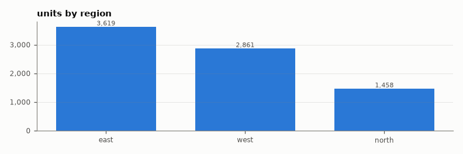
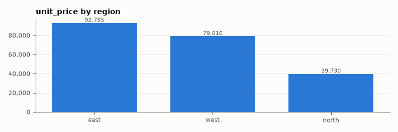
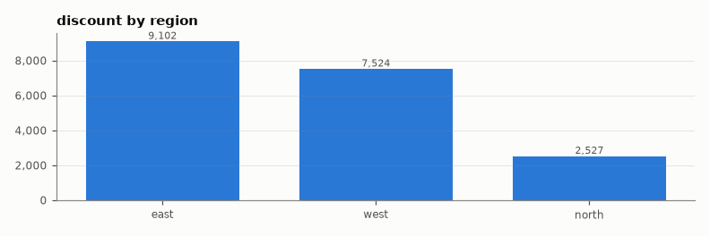
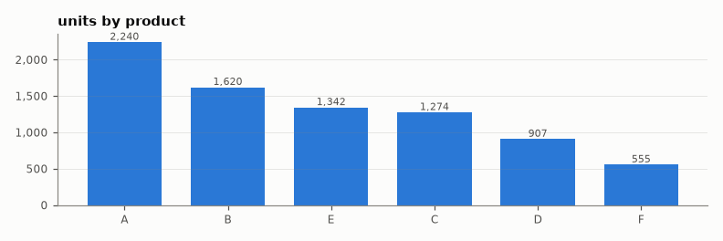
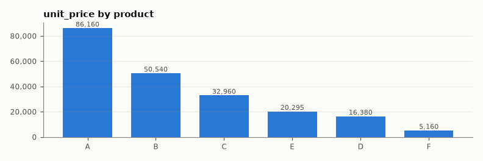
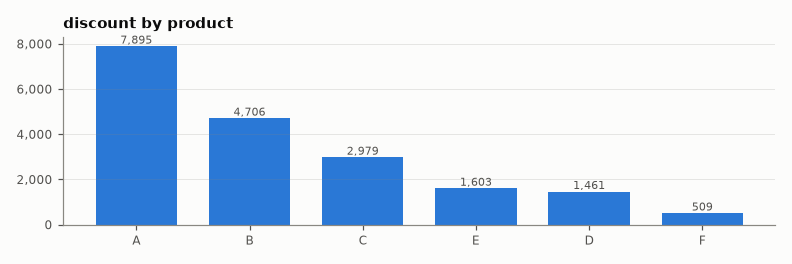

# Data report — business_demo3
*2026-07-29 · 2558 rows · 11 columns · engine time 7s*

## The headlines

- 3 row(s) break total=revenue+tax — the book doesn't balance there
- ↳ these are the rows an audit would circle; fix or explain before anyone else finds them
- 5 row(s) break the tax=0.08xrevenue rule the rest of the book obeys
- ↳ each one is either an entry error or an exception with a story — worth five minutes with the source records
- 13 high-value customer(s) have gone quiet past twice their own ordering rhythm
- ↳ this is a call list, not a statistic — the names are in the report
- units and revenue move together (r=+0.78) — SOLID
- ↳ useful for sanity-checking a forecast of one from the other; it does not say which causes which
- 71% of customers ordered more than once
- ↳ repeat business is the cheapest revenue there is — the gap number above says when to reach out
- the top 20% of customers carry 69% of total
- ↳ these are the relationships to protect — a single defection up there outweighs dozens below
- 67% of regulars' coupon redemptions arrived on their normal rhythm — likely subsidized anyway-purchases
- ↳ aim coupons at first-timers and lapsed customers, not the rhythm that already runs


## Column by column (plain English)

- **units** — no law-grade rule certified. what's there: no dependable direction — the apparent slope flips depending on which rows you look at (direction held in 76% of 200 random half-samples, in both the early and late halves; half-sample spread [-0.232, +0.09438] per unit date). We'd call this spurious rather than report it.
- **unit_price** — no law-grade rule certified. what's there: falling -1.743 per unit date (about -2.001 across the whole record) — WEAK: direction held in 86% of 200 random half-samples, in both the early and late halves; half-sample spread [-5.196, +1.525] per unit date. Caution: values follow each other strongly here (persistence -0.09), and drifts like this can appear in wandering data — after accounting for that, the direction is not dependable
- **discount** — no law-grade rule certified. what's there: falling -2.789 per unit date (about -3.202 across the whole record) — WEAK: direction held in 99% of 200 random half-samples, NOT in both the early and late halves; half-sample spread [-5.466, -0.52] per unit date. Caution: values follow each other strongly here (persistence 0.35), and drifts like this can appear in wandering data — after accounting for that, the direction is not dependable
- **revenue** — no law-grade rule certified. what's there: no dependable direction — the apparent slope flips depending on which rows you look at (direction held in 68% of 200 random half-samples, in both the early and late halves; half-sample spread [-24.88, +11.08] per unit date). We'd call this spurious rather than report it.
- **tax** — no law-grade rule certified. what's there: no dependable direction — the apparent slope flips depending on which rows you look at (direction held in 69% of 200 random half-samples, in both the early and late halves; half-sample spread [-1.996, +0.8717] per unit date). We'd call this spurious rather than report it.
- **total** — no law-grade rule certified. what's there: no dependable direction — the apparent slope flips depending on which rows you look at (direction held in 70% of 200 random half-samples, in both the early and late halves; half-sample spread [-26.84, +11.92] per unit date). We'd call this spurious rather than report it.

> Two kinds of claims above, kept honest: a **certified rule** passed our strictest checks; a **what's-there** description reports the plain trend graded by whether it survives 200 random half-samples (SOLID / WEAK / UNSTABLE) — described, never certified. Every claim traces to a receipt at the bottom; where we can't stand behind a number at all, we say so instead of guessing.

## What is in this data

- **date** (dates): 2025-01-01 to 2026-02-24, 2558 entries
- **order_id** (text): 1237 distinct values — profiled only, not aggregated
- **customer** (text): 475 distinct values — profiled only, not aggregated
- **region** (category): 3 groups; most common 'east' (1139 of 2558 rows)
- **product** (category): 6 groups; most common 'A' (718 of 2558 rows)
- **units** (number): 2558 values, 1 to 6, typical 3, mean 3.1, total 7,938
- **unit_price** (number): 2558 values, 30 to 120, typical 80, mean 82.7, total 211,495
- **discount** (number): 2558 values, 0 to 178, typical 0, mean 7.49, total 19,153
- **revenue** (number): 2558 values, 22.8 to 720, typical 204, mean 249, total 636,927
- **tax** (number): 2558 values, 1.82 to 84, typical 16.4, mean 20, total 51,088
- **total** (number): 2558 values, 24.6 to 778, typical 221, mean 269, total 688,090

## Month over month (period facts, exact)

- **units**: 2026-01 total 638, +4.4% vs 2025-12 (611); +11.5% vs the same month last year (572). The file's final month is part-way through and was left out of this comparison
- **unit_price**: 2026-01 total 17,045, +6.6% vs 2025-12 (15,985); +9.7% vs the same month last year (15,540). The file's final month is part-way through and was left out of this comparison
- **discount**: 2026-01 total 1,246, -21.9% vs 2025-12 (1,596); -14.0% vs the same month last year (1,449). The file's final month is part-way through and was left out of this comparison
- **units movers by region** (2025-12 → 2026-01): biggest riser 'north' (+54.8%, 51); biggest faller 'west' (-11.0%, -31)

## The customer base (from column 'customer')

- **475 distinct customers** across 2,558 orders — 5.4 orders per customer; **71% came back at least once**
- **top 5 customers carry 17% of total** (C1000, C1001, C1004, C1003, C1002); the top 20% of customers carry 69%
- average total per order 269; per customer 1,449
- in 2026-01: 70 active customers, 28 of them first-timers (42 returning)
- a returning customer typically comes back within 0 days (median gap between orders) — silence much longer than that is a customer drifting away

## High-value customers going quiet

- **C1000** — 37,456 lifetime total, normally orders every ~4 days, silent for 55 days (last seen 2025-12-31). That is 13.8x their own rhythm.
- **C1138** — 2,535 lifetime total, normally orders every ~24 days, silent for 301 days (last seen 2025-04-29). That is 12.5x their own rhythm.
- **C1002** — 14,910 lifetime total, normally orders every ~8 days, silent for 61 days (last seen 2025-12-25). That is 7.2x their own rhythm.
- **C1108** — 1,995 lifetime total, normally orders every ~38 days, silent for 264 days (last seen 2025-06-05). That is 6.9x their own rhythm.
- **C1052** — 3,910 lifetime total, normally orders every ~19 days, silent for 97 days (last seen 2025-11-19). That is 5.1x their own rhythm.

## The coupon question (column 'discount')

- **17% of orders carried a discount** (208 of 1,237); total given away 19,153 — that is the measurable cost side, exact
- **who redeems**: 88 coupon orders (42%) were a customer's FIRST-EVER order (acquisition); 120 (58%) went to customers you already had
- **the cannibalization signal**: of 114 coupon orders from established repeat customers, 67% arrived on the customer's normal ordering rhythm anyway — those discounts likely subsidized purchases that were coming regardless. Not a causal proof — a rhythm receipt.

## What sells together (orders from column 'order_id')

- 1,237 orders; 60% carry more than one distinct product; typical basket 2 line(s)
- **'C' and 'E' go together**: bought in the same order 1.8x more often than chance (273 orders) — SOLID (lift held in 100% of 200 half-samples of orders)

## Where the book doesn't balance (reconciliation)

- **total = revenue + tax** holds for 99.9% of rows — but NOT these: row 390: total=538 vs 513 expected; row 590: total=284 vs 259 expected; row 1702: total=198 vs 173 expected
- **tax runs at 0.08 x revenue** for 99.8% of rows — but NOT for these: row 427: tax=84 where 0.08xrevenue=38.4 expected; row 632: tax=16.8 where 0.08xrevenue=6.4 expected; row 1206: tax=37.3 where 0.08xrevenue=16.2 expected; row 1363: tax=18.4 where 0.08xrevenue=7.2 expected; row 1966: tax=83.1 where 0.08xrevenue=38 expected

## How the groups compare

- **units by region** — leader 'east' with 46% of the total, ahead of 'west' — SOLID (led in 100% of 200 random half-samples). Top groups: 'east' 3,619 (46%, 1139 rows, avg 3.18); 'west' 2,861 (36%, 943 rows, avg 3.03); 'north' 1,458 (18%, 476 rows, avg 3.06).

- **unit_price by region** — leader 'east' with 44% of the total, ahead of 'west' — SOLID (led in 100% of 200 random half-samples). Top groups: 'east' 92,755 (44%, 1139 rows, avg 81.4); 'west' 79,010 (37%, 943 rows, avg 83.8); 'north' 39,730 (19%, 476 rows, avg 83.5).

- **discount by region** — leader 'east' with 48% of the total, ahead of 'west' — WEAK (led in 91% of 200 random half-samples). Top groups: 'east' 9,102 (48%, 1139 rows, avg 7.99); 'west' 7,524 (39%, 943 rows, avg 7.98); 'north' 2,527 (13%, 476 rows, avg 5.31).


- **units by product** — leader 'A' with 28% of the total, ahead of 'B' — SOLID (led in 100% of 200 random half-samples). Top groups: 'A' 2,240 (28%, 718 rows, avg 3.12); 'B' 1,620 (20%, 532 rows, avg 3.05); 'E' 1,342 (17%, 451 rows, avg 2.98).

- **unit_price by product** — leader 'A' with 41% of the total, ahead of 'B' — SOLID (led in 100% of 200 random half-samples). Top groups: 'A' 86,160 (41%, 718 rows, avg 120); 'B' 50,540 (24%, 532 rows, avg 95); 'C' 32,960 (16%, 412 rows, avg 80).

- **discount by product** — leader 'A' with 41% of the total, ahead of 'B' — SOLID (led in 100% of 200 random half-samples). Top groups: 'A' 7,895 (41%, 718 rows, avg 11); 'B' 4,706 (25%, 532 rows, avg 8.85); 'C' 2,979 (16%, 412 rows, avg 7.23).


## What repeats

- **units by day of the week** — peak Tue (avg 3.65), trough Sun (avg 2.16), swing 1.49 — SOLID (pattern found on one random half confirmed on the unseen half in 100% of 200 tests)
- **units by month of the year** — peak Sep (avg 3.31), trough Nov (avg 2.8), swing 0.5079 — UNSTABLE (pattern found on one random half confirmed on the unseen half in 79% of 200 tests)
- **unit_price by day of the week**: no meaningful pattern (spread under 5% of the mean) — said plainly rather than decorated.
- **unit_price by month of the year** — peak May (avg 85.4), trough Jun (avg 79.9), swing 5.49 — UNSTABLE (pattern found on one random half confirmed on the unseen half in 16% of 200 tests)

## What moves together

- **units and revenue** move together (r=+0.78) — SOLID (sign held in 100% of half-samples, spread [+0.77, +0.80]). Link, not cause — we can't say which drives which from this table alone.
- **unit_price and revenue** move together (r=+0.54) — SOLID (sign held in 100% of half-samples, spread [+0.52, +0.56]). Link, not cause — we can't say which drives which from this table alone.

## Where the weight sits

- **units**: top 20% of rows carry 36% of the total — fairly evenly spread.
- **unit_price**: top 20% of rows carry 29% of the total — fairly evenly spread.
- **revenue**: top 20% of rows carry 42% of the total — fairly evenly spread.
- **tax**: top 20% of rows carry 42% of the total — fairly evenly spread.
- **total**: top 20% of rows carry 42% of the total — fairly evenly spread.


## The receipts — analyst face (verbatim)

```
THE ANALYST'S REPORT — business_demo3.normalized.csv
  2558 rows; time key: date (told — duplicate timestamps present (step read from median spacing))
    date: 2025.00137 .. 2026.149315
    units: 1.0 .. 6.0
    unit_price: 30.0 .. 120.0
    discount: 0.0 .. 178.15
    revenue: 22.78 .. 720.0
    tax: 1.82 .. 83.97
    total: 24.6 .. 777.6
  ── units ──
    trend [NO RULE]: NO RULE (nothing beat the null)
    the books: trend 0.0% + seasonal 0.0% + residual 100.0% = 100
    receipt: period: best autocorr 0.07 <= null 0.09 — no cycle said
    receipt: trend: NO RULE — flat (mean) stands, said
    forecast next 12: 0.0 .. 0.0 (last seen 4.0)
    watch: BASELINE (err_norm 1.0) — arriving data will be judged
  ── unit_price ──
    trend [NO RULE]: NO RULE (nothing beat the null)
    the books: trend 0.0% + seasonal 0.0% + residual 100.0% = 100
    receipt: period: best autocorr 0.07 <= null 0.09 — no cycle said
    receipt: trend: NO RULE — flat (mean) stands, said
    forecast next 12: 0.0 .. 0.0 (last seen 45.0)
    watch: BASELINE (err_norm 1.0) — arriving data will be judged
  ── discount ──
    trend [NO RULE]: +7.86*sin(110*x0)*sin(112.5*x0) +5.91
    the books: trend 0.0% + seasonal 0.0% + residual 100.0% = 100
    receipt: period: best autocorr 0.09 <= null 0.12 — no cycle said
    receipt: trend: NO RULE — flat (mean) stands, said
    anomalies: 5 flagged (worst 7.8x at t=2025.3795) — flagged beyond 4x residual rms — named, never judged
    forecast next 12: 0.0 .. 0.0 (last seen 0.0)
    watch: BASELINE (err_norm 1.0) — arriving data will be judged
  ── revenue ──
    trend [NO RULE]: NO RULE (nothing beat the null)
    the books: trend 0.0% + seasonal 0.0% + residual 100.0% = 100
    receipt: period: best autocorr 0.07 <= null 0.09 — no cycle said
    receipt: trend: NO RULE — flat (mean) stands, said
    forecast next 12: 0.0 .. 0.0 (last seen 180.0)
    watch: BASELINE (err_norm 1.0) — arriving data will be judged
  ── tax ──
    trend [NO RULE]: NO RULE (nothing beat the null)
    the books: trend 0.0% + seasonal 0.0% + residual 100.0% = 100
    receipt: period: best autocorr 0.07 <= null 0.08 — no cycle said
    receipt: trend: NO RULE — flat (mean) stands, said
    forecast next 12: 0.0 .. 0.0 (last seen 14.4)
    watch: BASELINE (err_norm 1.0) — arriving data will be judged
  ── total ──
    trend [NO RULE]: NO RULE (nothing beat the null)
    the books: trend 0.0% + seasonal 0.0% + residual 100.0% = 100
    receipt: period: best autocorr 0.07 <= null 0.09 — no cycle said
    receipt: trend: NO RULE — flat (mean) stands, said
    forecast next 12: 0.0 .. 0.0 (last seen 194.4)
    watch: BASELINE (err_norm 1.0) — arriving data will be judged
  ── relations ──
    units ~ revenue: RELATED corr 0.161 vs null 0.057 (same-step); levels 0.192 — levels co-move trivially under shared trends — reported, never judged
    units ~ tax: RELATED corr 0.162 vs null 0.057 (same-step); levels 0.195 — levels co-move trivially under shared trends — reported, never judged
    units ~ total: RELATED corr 0.161 vs null 0.057 (same-step); levels 0.192 — levels co-move trivially under shared trends — reported, never judged
    unit_price ~ revenue: RELATED corr -0.142 vs null 0.054 (a leads by 1); levels 0.079 — levels co-move trivially under shared trends — reported, never judged
    unit_price ~ tax: RELATED corr -0.142 vs null 0.054 (a leads by 1); levels 0.079 — levels co-move trivially under shared trends — reported, never judged
    unit_price ~ total: RELATED corr -0.142 vs null 0.054 (a leads by 1); levels 0.079 — levels co-move trivially under shared trends — reported, never judged
    revenue ~ tax: RELATED corr 0.211 vs null 0.054 (same-step); levels 0.195 — levels co-move trivially under shared trends — reported, never judged
    revenue ~ total: RELATED corr 0.21 vs null 0.053 (same-step); levels 0.193 — levels co-move trivially under shared trends — reported, never judged
    tax ~ total: RELATED corr 0.211 vs null 0.052 (same-step); levels 0.194 — levels co-move trivially under shared trends — reported, never judged
    refused pairs: 6 (the null was not beaten — receipts kept)
  ── the dossier (node dossier:business_demo3.normalized) ──
    units: n 2558, mean 3.10321, median 3, std 1.64493
      mode 2 (x563); resolution 1; lo 1 / hi 6 (rows kept)
    unit_price: n 2558, mean 82.6798, median 80, std 30.2629
      mode 120 (x718); resolution: none read; lo 30 / hi 120 (rows kept)
    discount: n 2558, mean 7.48745, median 0, std 21.7094
      mode 0 (x2124); resolution 0.01; lo 0 / hi 178.15 (rows kept)
    revenue: n 2558, mean 248.994, median 204.37, std 168.975
      mode 240 (x226); resolution 0.01; lo 22.78 / hi 720 (rows kept)
    tax: n 2558, mean 19.9717, median 16.425, std 13.6243
      mode 19.2 (x226); resolution 0.01; lo 1.82 / hi 83.97 (rows kept)
    total: n 2558, mean 268.995, median 221.325, std 182.545
      mode 259.2 (x225); resolution 0.01; lo 24.6 / hi 777.6 (rows kept)
    examples: 21 rows remembered of 2558 (extremes + even spread by outcome rank (the facts-layer sampler, reused))
    frames/year: 2 buckets; total avg 270.615 (2025) -> 258.975 (2026)
    frames/month: 14 buckets; total avg 260.093 (2025-01) -> 265.317 (2026-02); slope -7.24361/yr (described, not judged)
    frames/day: 420 buckets; total avg 196.791 (2025-06-30) -> 311.85 (2026-02-24); slope -13.1389/yr (described, not judged)
    ratio units/unit_price: mean 0.0449895 (0.00833333 .. 0.2)
    ratio units/discount: refused — denominator crosses or touches zero — a ratio there is a lie waiting
    ratio units/revenue: mean 0.0150111 (0.00833333 .. 0.0439367)
    ratio units/tax: mean 0.187428 (0.0476361 .. 0.549451)
    ratio units/total: mean 0.0138955 (0.00709258 .. 0.0406835)
    ratio unit_price/discount: refused — denominator crosses or touches zero — a ratio there is a lie waiting
    ratio unit_price/revenue: mean 0.479902 (0.166667 .. 1.3296)
    ratio unit_price/tax: mean 5.99205 (1.14279 .. 16.6205)
    ratio unit_price/total: mean 0.444234 (0.154321 .. 1.23105)
    ratio discount/revenue: mean 0.0371383 (0 .. 0.332889)
    ratio discount/tax: mean 0.463737 (0 .. 4.1625)
    ratio discount/total: mean 0.0343815 (0 .. 0.308238)
    ratio revenue/tax: mean 12.486 (4.77042 .. 12.5282)
    ratio revenue/total: mean 0.925665 (0.808898 .. 0.92608)
    ratio tax/total: mean 0.0742328 (0.0647118 .. 0.173298)
```