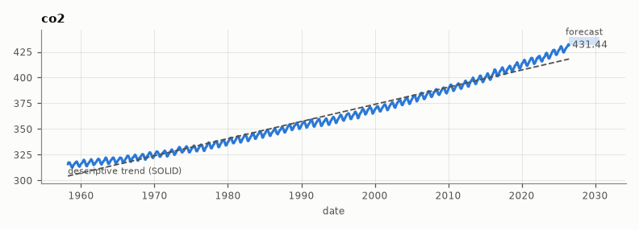

# Data report — co2_face
*2026-07-29 · 820 rows · 2 columns · engine time 17s*

## The headlines

- co2 is rising (about 114 across the record) — SOLID
- ↳ if the pace holds, roughly 28.5 more over the next quarter of a record this length — extrapolation, plainly labeled


## Column by column (plain English)

- **co2** — found a pattern explaining 99% of the movement (trend 99%, cycle 0%, unexplained 1%); a repeating cycle (period 0.9987, profile swing 6.2265); forecast for the next 12 steps: 431.7863 .. 439.5327 (last seen 431.44); the fitted rule, readable, is `+0.21*x0^1.5 +316.26`. what's there: rising +1.668 per unit date (about +113.8 across the whole record) — SOLID: direction held in 100% of 200 random half-samples, in both the early and late halves; half-sample spread [+1.647, +1.692] per unit date
- **Data quality** — audit verdict PARTIAL; 0 error / 0 news / 0 duplicate / 5 unvalidatable / 815 unflagged.

> Two kinds of claims above, kept honest: a **certified rule** passed our strictest checks; a **what's-there** description reports the plain trend graded by whether it survives 200 random half-samples (SOLID / WEAK / UNSTABLE) — described, never certified. Every claim traces to a receipt at the bottom; where we can't stand behind a number at all, we say so instead of guessing.

## What is in this data

- **date** (number): 820 values, 1,958 to 2,026, typical 1,992, mean 1,992, total 1.63M
- **co2** (number): 820 values, 312 to 432, typical 356, mean 361, total 296,182

## What moves together

- no pair of number columns moves together beyond r=0.3 — said plainly.

## Where the weight sits

- **date**: top 20% of rows carry 20% of the total — fairly evenly spread.
- **co2**: top 20% of rows carry 23% of the total — fairly evenly spread.


## Charts



## The receipts — analyst face (verbatim)

```
THE ANALYST'S REPORT — co2_face.normalized.csv
  820 rows; time key: date (auto: 'date' strictly increases)
    date: 1958.2027 .. 2026.4583
    co2: 312.42 .. 432.34
  ── co2 ──
    trend [PARTIAL]: +0.21*x0^1.5 +316.26
    cycle: period 0.9987, profile swing 6.2265
    the books: trend 99.1% + seasonal 0.4% + residual 0.6% = 100
    forecast next 12: 431.7863 .. 439.5327 (last seen 431.44)
    watch: BASELINE (err_norm 0.012707) — arriving data will be judged
  ── relations ──
    none said
  ── the dossier (node dossier:co2_face.normalized) ──
    co2: n 820, mean 361.197, median 356.32, std 33.3326
      mode 336.14 (x3); resolution 0.01; lo 312.42 / hi 432.34 (rows kept)
    examples: 14 rows remembered of 820 (extremes + even spread by outcome rank (the facts-layer sampler, reused))
    frames/year: 69 buckets; co2 avg 315.237 (1958) -> 430.503 (2026); slope 1.67446/yr (described, not judged)
    frames/month: skipped — data already at this grain — averaging would change nothing
    frames/day: skipped — data already at this grain — averaging would change nothing
```

## The receipts — audit face (verbatim)

```
ISAAC — the audit
============================================================

TABLE co2_face.normalized.csv   target: co2   rows: 820
  VERDICT: PARTIAL
    co2 = +0.00*date[t-5]*date[t-5] -474.89*|date-date[t-5]| -8.62*|date-date[t-5]|*[date>1963.5] +0.00*date[t-5]*date[t-5]*[date[t-3]>1987] -738.87
  floor[co2]: 0.00288675 via grain
  floor[date]: 0.0240466 via grain
  flags: refused (evidenced floor 0.00288675 does not cover the residual spread 5.32712: EITHER the floor under-evidences — ASK for the true resolution, never loosen the gate — OR the discovered law does not hold at that precision and the residual carries structure the law missed; the verdict rewrite is the deeper cure)
  counts: 0 error / 0 news / 0 duplicate / 5 unvalidatable / 815 unflagged

COMPLETE NUMBERS
  1 tables, 820 rows audited; 0 error / 0 news / 0 duplicate flags; 5 unvalidatable; 1 laws; 1 flag refusals; asks: none

[3 records -> audit.jsonl]
```