# Data report — gistemp_glb
*2026-07-29 · 147 rows · 19 columns · engine time 8s*

## The headlines

- Mar is rising (about 1.35 across the record) — SOLID
- ↳ if the pace holds, roughly 0.3384 more over the next quarter of a record this length — extrapolation, plainly labeled
- Jan is rising (about 1.32 across the record) — SOLID
- ↳ if the pace holds, roughly 0.3295 more over the next quarter of a record this length — extrapolation, plainly labeled
- Feb is rising (about 1.31 across the record) — SOLID
- ↳ if the pace holds, roughly 0.3275 more over the next quarter of a record this length — extrapolation, plainly labeled
- DJF is rising (about 1.28 across the record) — SOLID
- ↳ if the pace holds, roughly 0.3198 more over the next quarter of a record this length — extrapolation, plainly labeled
- MAM is rising (about 1.27 across the record) — SOLID
- ↳ if the pace holds, roughly 0.317 more over the next quarter of a record this length — extrapolation, plainly labeled
- Apr is rising (about 1.25 across the record) — SOLID
- ↳ if the pace holds, roughly 0.3128 more over the next quarter of a record this length — extrapolation, plainly labeled
- Jun is rising (about 1.21 across the record) — SOLID
- ↳ if the pace holds, roughly 0.3037 more over the next quarter of a record this length — extrapolation, plainly labeled


## Column by column (plain English)

- **Jan** — no law-grade rule certified. what's there: rising +0.009027 per unit Year (about +1.318 across the whole record) — SOLID: direction held in 100% of 200 random half-samples, in both the early and late halves; half-sample spread [+0.007857, +0.01002] per unit Year
- **Feb** — no law-grade rule certified. what's there: rising +0.008972 per unit Year (about +1.31 across the whole record) — SOLID: direction held in 100% of 200 random half-samples, in both the early and late halves; half-sample spread [+0.008019, +0.01005] per unit Year
- **Mar** — no law-grade rule certified. what's there: rising +0.009272 per unit Year (about +1.354 across the whole record) — SOLID: direction held in 100% of 200 random half-samples, in both the early and late halves; half-sample spread [+0.008182, +0.01037] per unit Year
- **Apr** — found a pattern explaining 88% of the movement (trend 85%, cycle 3%, unexplained 12%); a repeating cycle (period 46.964, profile swing 0.431); forecast for the next 12 steps: 0.9737 .. 1.3833 (last seen 1.24); the fitted rule, readable, is `+0.00*x0*x0 +0.54*exp(-0.8*x0) -0.35`. what's there: rising +0.00857 per unit Year (about +1.251 across the whole record) — SOLID: direction held in 100% of 200 random half-samples, in both the early and late halves; half-sample spread [+0.007532, +0.009526] per unit Year
- **May** — no law-grade rule certified. what's there: rising +0.008203 per unit Year (about +1.198 across the whole record) — SOLID: direction held in 100% of 200 random half-samples, in both the early and late halves; half-sample spread [+0.007271, +0.009104] per unit Year
- **Jun** — no law-grade rule certified. what's there: rising +0.008321 per unit Year (about +1.215 across the whole record) — SOLID: direction held in 100% of 200 random half-samples, in both the early and late halves; half-sample spread [+0.007346, +0.009218] per unit Year
- **Jul** — no law-grade rule certified. what's there: rising +0.007669 per unit Year (about +1.112 across the whole record) — SOLID: direction held in 100% of 200 random half-samples, in both the early and late halves; half-sample spread [+0.006679, +0.008499] per unit Year
- **Aug** — found a repeating cycle (period 14.0471 (shape refused past the null)); no law-grade trend certified. what's there: rising +0.007995 per unit Year (about +1.159 across the whole record) — SOLID: direction held in 100% of 200 random half-samples, in both the early and late halves; half-sample spread [+0.007068, +0.008865] per unit Year
- **Sep** — no law-grade rule certified. what's there: rising +0.007969 per unit Year (about +1.155 across the whole record) — SOLID: direction held in 100% of 200 random half-samples, in both the early and late halves; half-sample spread [+0.007028, +0.008839] per unit Year
- **Oct** — no law-grade rule certified. what's there: rising +0.00796 per unit Year (about +1.154 across the whole record) — SOLID: direction held in 100% of 200 random half-samples, in both the early and late halves; half-sample spread [+0.007108, +0.008893] per unit Year
- **Nov** — no law-grade rule certified. what's there: rising +0.008169 per unit Year (about +1.185 across the whole record) — SOLID: direction held in 100% of 200 random half-samples, in both the early and late halves; half-sample spread [+0.007265, +0.009244] per unit Year
- **Dec** — no law-grade rule certified. what's there: rising +0.008257 per unit Year (about +1.197 across the whole record) — SOLID: direction held in 100% of 200 random half-samples, in both the early and late halves; half-sample spread [+0.007054, +0.009256] per unit Year
- **J-D** — no law-grade rule certified. what's there: rising +0.0083 per unit Year (about +1.203 across the whole record) — SOLID: direction held in 100% of 200 random half-samples, in both the early and late halves; half-sample spread [+0.007294, +0.00916] per unit Year
- **D-N** — no law-grade rule certified. what's there: rising +0.008365 per unit Year (about +1.205 across the whole record) — SOLID: direction held in 100% of 200 random half-samples, in both the early and late halves; half-sample spread [+0.007461, +0.009396] per unit Year
- **DJF** — no law-grade rule certified. what's there: rising +0.008821 per unit Year (about +1.279 across the whole record) — SOLID: direction held in 100% of 200 random half-samples, in both the early and late halves; half-sample spread [+0.007765, +0.009815] per unit Year
- **MAM** — found a repeating cycle (period 36.9871 (shape refused past the null)); no law-grade trend certified. what's there: rising +0.008685 per unit Year (about +1.268 across the whole record) — SOLID: direction held in 100% of 200 random half-samples, in both the early and late halves; half-sample spread [+0.007676, +0.009617] per unit Year
- **JJA** — no law-grade rule certified. what's there: rising +0.00795 per unit Year (about +1.153 across the whole record) — SOLID: direction held in 100% of 200 random half-samples, in both the early and late halves; half-sample spread [+0.007012, +0.008762] per unit Year
- **SON** — no law-grade rule certified. what's there: rising +0.008034 per unit Year (about +1.165 across the whole record) — SOLID: direction held in 100% of 200 random half-samples, in both the early and late halves; half-sample spread [+0.00719, +0.008928] per unit Year

> Two kinds of claims above, kept honest: a **certified rule** passed our strictest checks; a **what's-there** description reports the plain trend graded by whether it survives 200 random half-samples (SOLID / WEAK / UNSTABLE) — described, never certified. Every claim traces to a receipt at the bottom; where we can't stand behind a number at all, we say so instead of guessing.

## What we did to your file first (receipted)

- skipped title row: 'Land-Ocean: Global Means'
- blanked 12 missing-value marker(s) (***, NA, null, ...)

## What is in this data

- **Year** (number): 147 values, 1,880 to 2,026, typical 1,953, mean 1,953, total 287,091
- **Jan** (number): 147 values, -0.81 to 1.38, typical -0.01, mean 0.08449, total 12.4
- **Feb** (number): 147 values, -0.63 to 1.43, typical -0.03, mean 0.09367, total 13.8
- **Mar** (number): 147 values, -0.63 to 1.39, typical 0.02, mean 0.112, total 16.5
- **Apr** (number): 147 values, -0.59 to 1.32, typical 0, mean 0.08408, total 12.4
- **May** (number): 147 values, -0.55 to 1.16, typical -0.03, mean 0.07204, total 10.6
- **Jun** (number): 147 values, -0.52 to 1.23, typical -0.05, mean 0.06075, total 8.93
- **Jul** (number, 1 missing): 146 values, -0.51 to 1.2, typical -0.03, mean 0.07685, total 11.2
- **Aug** (number, 1 missing): 146 values, -0.55 to 1.3, typical -0.04, mean 0.07671, total 11.2
- **Sep** (number, 1 missing): 146 values, -0.58 to 1.48, typical -0.05, mean 0.08308, total 12.1
- **Oct** (number, 1 missing): 146 values, -0.58 to 1.35, typical 0.01, mean 0.1074, total 15.7
- **Nov** (number, 1 missing): 146 values, -0.57 to 1.4, typical 0.02, mean 0.09938, total 14.5
- **Dec** (number, 1 missing): 146 values, -0.82 to 1.35, typical -0.04, mean 0.07308, total 10.7
- **J-D** (number, 1 missing): 146 values, -0.49 to 1.28, typical -0.03, mean 0.08164, total 11.9
- **D-N** (number, 2 missing): 145 values, -0.49 to 1.29, typical -0.04, mean 0.08297, total 12
- **DJF** (number, 1 missing): 146 values, -0.67 to 1.35, typical -0.025, mean 0.085, total 12.4
- **MAM** (number): 147 values, -0.58 to 1.29, typical 0, mean 0.08946, total 13.1
- **JJA** (number, 1 missing): 146 values, -0.5 to 1.24, typical -0.04, mean 0.06911, total 10.1
- **SON** (number, 1 missing): 146 values, -0.52 to 1.41, typical -0.01, mean 0.09644, total 14.1

## What moves together

- **Jan and Feb** move together (r=+0.95) — SOLID (sign held in 100% of half-samples, spread [+0.92, +0.96]); still r=+0.83 with the shared time-trend removed. Link, not cause — we can't say which drives which from this table alone.
- **Jan and Mar** move together (r=+0.93) — SOLID (sign held in 100% of half-samples, spread [+0.90, +0.95]); still r=+0.74 with the shared time-trend removed. Link, not cause — we can't say which drives which from this table alone.
- **Jan and Apr** move together (r=+0.94) — SOLID (sign held in 100% of half-samples, spread [+0.91, +0.95]); still r=+0.77 with the shared time-trend removed. Link, not cause — we can't say which drives which from this table alone.
- **Feb and Mar** move together (r=+0.94) — SOLID (sign held in 100% of half-samples, spread [+0.91, +0.95]); still r=+0.78 with the shared time-trend removed. Link, not cause — we can't say which drives which from this table alone.
- **Feb and Apr** move together (r=+0.94) — SOLID (sign held in 100% of half-samples, spread [+0.91, +0.95]); still r=+0.78 with the shared time-trend removed. Link, not cause — we can't say which drives which from this table alone.
- **Mar and Apr** move together (r=+0.97) — SOLID (sign held in 100% of half-samples, spread [+0.96, +0.98]); still r=+0.89 with the shared time-trend removed. Link, not cause — we can't say which drives which from this table alone.

## Where the weight sits

- **Year**: top 20% of rows carry 20% of the total — fairly evenly spread.

## What sticks out

- **Sep**: value 1.48 sits far outside the rest (8x the typical spread from the middle -0.05) — worth a look, kept as-is.


## Charts

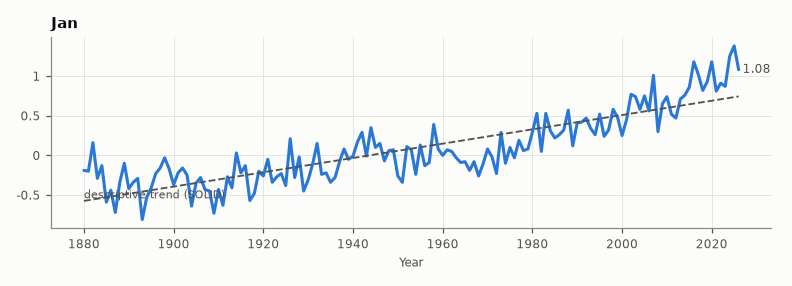
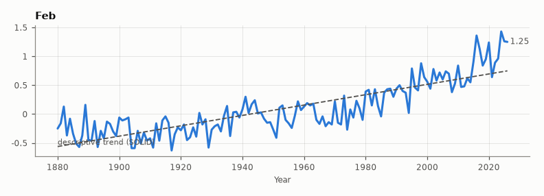
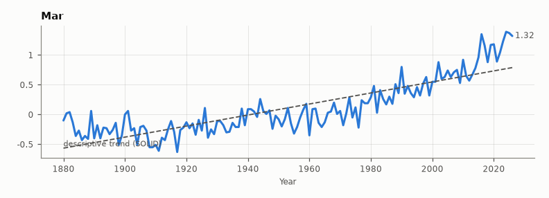
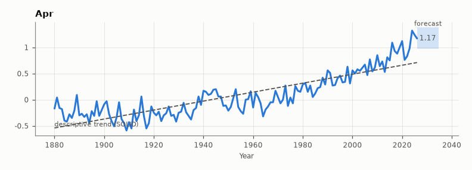
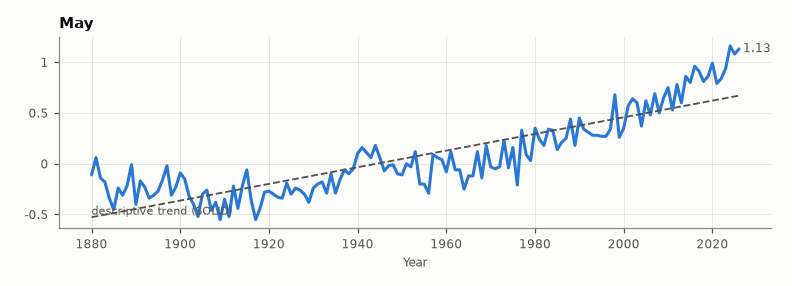
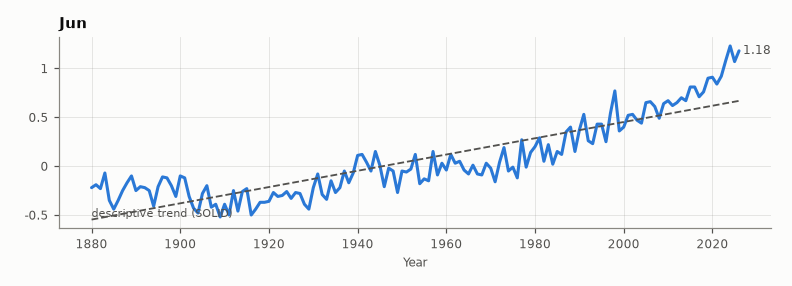
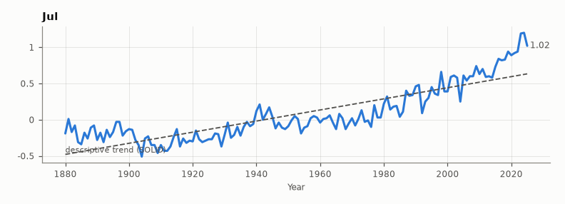
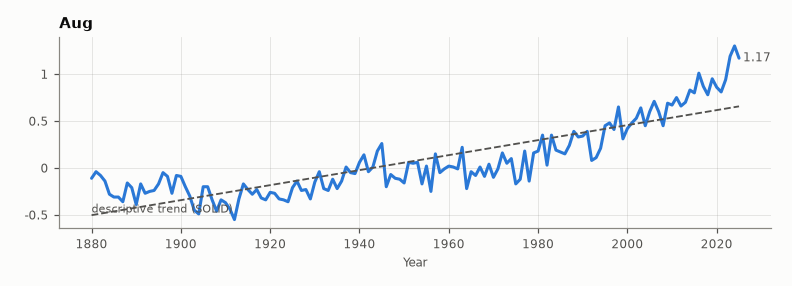
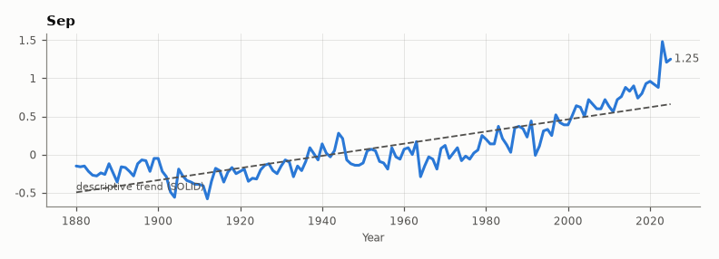
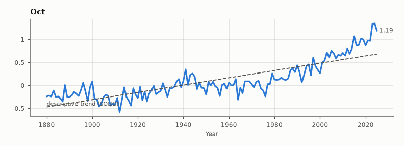
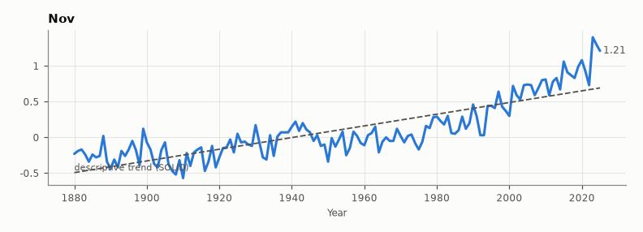
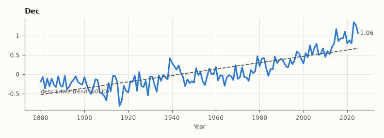

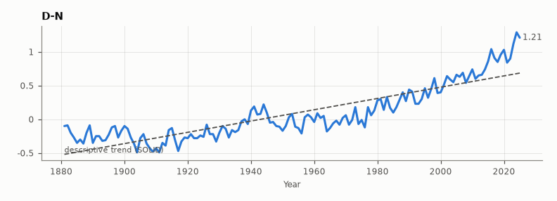
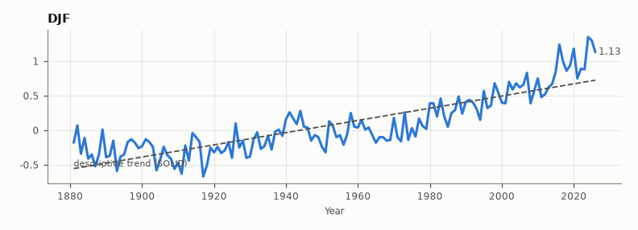
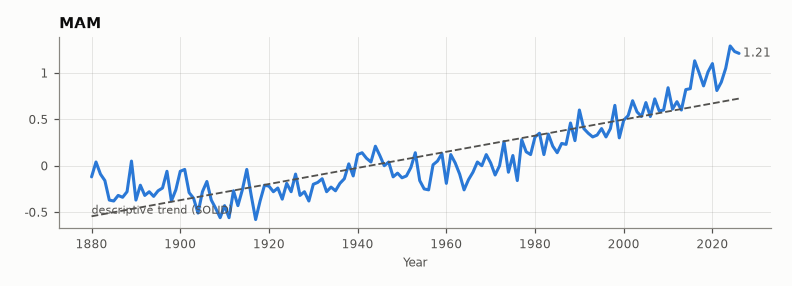
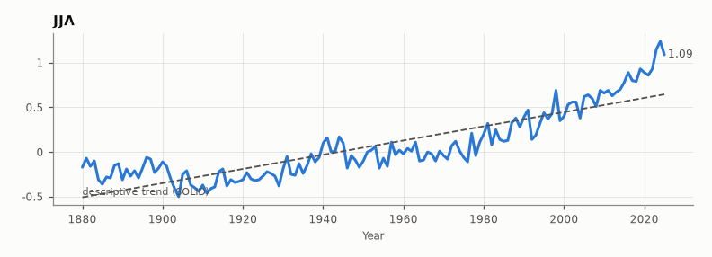
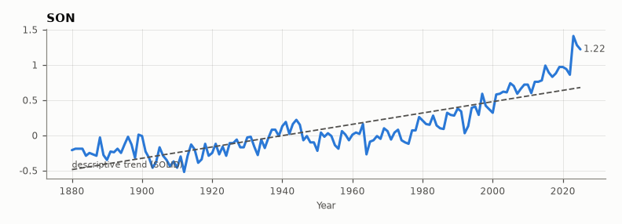

## The receipts — analyst face (verbatim)

```
THE ANALYST'S REPORT — gistemp_glb.normalized.csv
  145 rows; time key: Year (auto: 'Year' strictly increases)
    Year: 1881.0 .. 2025.0
    Jan: -0.81 .. 1.38
    Feb: -0.63 .. 1.43
    Mar: -0.63 .. 1.39
    Apr: -0.59 .. 1.32
    May: -0.55 .. 1.16
    Jun: -0.52 .. 1.23
    Jul: -0.51 .. 1.2
    Aug: -0.55 .. 1.3
    Sep: -0.58 .. 1.48
    Oct: -0.58 .. 1.35
    Nov: -0.57 .. 1.4
    Dec: -0.82 .. 1.35
    J-D: -0.49 .. 1.28
    D-N: -0.49 .. 1.29
    DJF: -0.67 .. 1.35
    MAM: -0.58 .. 1.29
    JJA: -0.5 .. 1.24
    SON: -0.52 .. 1.41
  ── Jan ──
    trend [NO RULE]: +0.00*x0*x0 -0.37
    the books: trend 0.0% + seasonal 0.0% + residual 100.0% = 100
    receipt: period: best autocorr 0.31 <= null 0.35 — no cycle said
    receipt: trend: NO RULE — flat (mean) stands, said
    forecast next 12: 0.0 .. 0.0 (last seen 1.38)
    watch: BASELINE (err_norm 1.0) — arriving data will be judged
  ── Feb ──
    trend [NO RULE]: +0.27*[x0>52.5] +0.10*sin(1*x0) -0.29
    the books: trend 0.0% + seasonal 0.0% + residual 100.0% = 100
    receipt: period: best autocorr 0.31 <= null 0.31 — no cycle said
    receipt: trend: NO RULE — flat (mean) stands, said
    forecast next 12: 0.0 .. 0.0 (last seen 1.26)
    watch: BASELINE (err_norm 1.0) — arriving data will be judged
  ── Mar ──
    trend [NO RULE]: +0.00*exp(0.5*x0) -0.26
    the books: trend 0.0% + seasonal 0.0% + residual 100.0% = 100
    receipt: period: best autocorr 0.26 <= null 0.31 — no cycle said
    receipt: trend: NO RULE — flat (mean) stands, said
    forecast next 12: 0.0 .. 0.0 (last seen 1.37)
    watch: BASELINE (err_norm 1.0) — arriving data will be judged
  ── Apr ──
    trend [PARTIAL]: +0.00*x0*x0 +0.54*exp(-0.8*x0) -0.35
    cycle: period 46.964, profile swing 0.431
    the books: trend 85.2% + seasonal 3.0% + residual 11.8% = 100
    forecast next 12: 0.9737 .. 1.3833 (last seen 1.24)
    watch: BASELINE (err_norm 0.199707) — arriving data will be judged
  ── May ──
    trend [NO RULE]: +0.00*exp(0.5*x0) -0.27
    the books: trend 0.0% + seasonal 0.0% + residual 100.0% = 100
    receipt: period: best autocorr 0.32 <= null 0.37 — no cycle said
    receipt: trend: NO RULE — flat (mean) stands, said
    forecast next 12: 0.0 .. 0.0 (last seen 1.08)
    watch: BASELINE (err_norm 1.0) — arriving data will be judged
  ── Jun ──
    trend [NO RULE]: +0.26*[x0>57] -0.28
    the books: trend 0.0% + seasonal 0.0% + residual 100.0% = 100
    receipt: period: best autocorr 0.25 <= null 0.31 — no cycle said
    receipt: trend: NO RULE — flat (mean) stands, said
    forecast next 12: 0.0 .. 0.0 (last seen 1.07)
    watch: BASELINE (err_norm 1.0) — arriving data will be judged
  ── Jul ──
    trend [NO RULE]: +0.22*[x0>52.5] -0.24
    the books: trend 0.0% + seasonal 0.0% + residual 100.0% = 100
    receipt: period: best autocorr 0.24 <= null 0.29 — no cycle said
    receipt: trend: NO RULE — flat (mean) stands, said
    forecast next 12: 0.0 .. 0.0 (last seen 1.02)
    watch: BASELINE (err_norm 1.0) — arriving data will be judged
  ── Aug ──
    trend [NO RULE]: +0.23*[x0>52.5] -0.26
    cycle: period 14.0471 (shape refused past the null)
    the books: trend 0.0% + seasonal 0.0% + residual 100.0% = 100
    receipt: profile: explains 0.14 <= null 0.22 — period said, shape refused
    receipt: trend: NO RULE — flat (mean) stands, said
    forecast next 12: 0.0 .. 0.0 (last seen 1.17)
    watch: BASELINE (err_norm 1.0) — arriving data will be judged
  ── Sep ──
    trend [NO RULE]: +0.23*[x0>52.5] -0.24
    the books: trend 0.0% + seasonal 0.0% + residual 100.0% = 100
    receipt: period: best autocorr 0.29 <= null 0.31 — no cycle said
    receipt: trend: NO RULE — flat (mean) stands, said
    forecast next 12: 0.0 .. 0.0 (last seen 1.25)
    watch: BASELINE (err_norm 1.0) — arriving data will be judged
  ── Oct ──
    trend [NO RULE]: +0.26*[x0>52.5] -0.22
    the books: trend 0.0% + seasonal 0.0% + residual 100.0% = 100
    receipt: period: best autocorr 0.19 <= null 0.31 — no cycle said
    receipt: trend: NO RULE — flat (mean) stands, said
    forecast next 12: 0.0 .. 0.0 (last seen 1.19)
    watch: BASELINE (err_norm 1.0) — arriving data will be judged
  ── Nov ──
    trend [NO RULE]: +0.24*[x0>43] +0.10*sin(6*x0) -0.25
    the books: trend 0.0% + seasonal 0.0% + residual 100.0% = 100
    receipt: period: best autocorr 0.25 <= null 0.34 — no cycle said
    receipt: trend: NO RULE — flat (mean) stands, said
    forecast next 12: 0.0 .. 0.0 (last seen 1.21)
    watch: BASELINE (err_norm 1.0) — arriving data will be judged
  ── Dec ──
    trend [NO RULE]: +0.29*[x0>52.5] -0.21*sin(0.5*x0)*[x0>52.5] -0.28
    the books: trend 0.0% + seasonal 0.0% + residual 100.0% = 100
    receipt: period: best autocorr 0.20 <= null 0.32 — no cycle said
    receipt: trend: NO RULE — flat (mean) stands, said
    forecast next 12: 0.0 .. 0.0 (last seen 1.06)
    watch: BASELINE (err_norm 1.0) — arriving data will be judged
  ── J-D ──
    trend [NO RULE]: +0.25*[x0>52.5] -0.26
    the books: trend 0.0% + seasonal 0.0% + residual 100.0% = 100
    receipt: period: best autocorr 0.25 <= null 0.30 — no cycle said
    receipt: trend: NO RULE — flat (mean) stands, said
    forecast next 12: 0.0 .. 0.0 (last seen 1.19)
    watch: BASELINE (err_norm 1.0) — arriving data will be judged
  ── D-N ──
    trend [NO RULE]: +0.24*[x0>52.5] -0.26
    the books: trend 0.0% + seasonal 0.0% + residual 100.0% = 100
    receipt: period: best autocorr 0.29 <= null 0.30 — no cycle said
    receipt: trend: NO RULE — flat (mean) stands, said
    forecast next 12: 0.0 .. 0.0 (last seen 1.21)
    watch: BASELINE (err_norm 1.0) — arriving data will be judged
  ── DJF ──
    trend [NO RULE]: +0.00*exp(0.6*x0) -0.30
    the books: trend 0.0% + seasonal 0.0% + residual 100.0% = 100
    receipt: period: best autocorr 0.26 <= null 0.30 — no cycle said
    receipt: trend: NO RULE — flat (mean) stands, said
    forecast next 12: 0.0 .. 0.0 (last seen 1.3)
    watch: BASELINE (err_norm 1.0) — arriving data will be judged
  ── MAM ──
    trend [NO RULE]: +0.00*exp(0.5*x0) -0.27
    cycle: period 36.9871 (shape refused past the null)
    the books: trend 0.0% + seasonal 0.0% + residual 100.0% = 100
    receipt: profile: explains 0.25 <= null 0.33 — period said, shape refused
    receipt: trend: NO RULE — flat (mean) stands, said
    forecast next 12: 0.0 .. 0.0 (last seen 1.23)
    watch: BASELINE (err_norm 1.0) — arriving data will be judged
  ── JJA ──
    trend [NO RULE]: +0.23*[x0>52.5] -0.26
    the books: trend 0.0% + seasonal 0.0% + residual 100.0% = 100
    receipt: period: best autocorr 0.27 <= null 0.30 — no cycle said
    receipt: trend: NO RULE — flat (mean) stands, said
    forecast next 12: 0.0 .. 0.0 (last seen 1.09)
    watch: BASELINE (err_norm 1.0) — arriving data will be judged
  ── SON ──
    trend [NO RULE]: +0.00*exp(0.65*x0) +0.09*sin(6*x0) -0.25
    the books: trend 0.0% + seasonal 0.0% + residual 100.0% = 100
    receipt: period: best autocorr 0.27 <= null 0.35 — no cycle said
    receipt: trend: NO RULE — flat (mean) stands, said
    forecast next 12: 0.0 .. 0.0 (last seen 1.22)
    watch: BASELINE (err_norm 1.0) — arriving data will be judged
  ── relations ──
    Jan ~ Feb: RELATED corr 0.681 vs null 0.325 (same-step); levels 0.947 — levels co-move trivially under shared trends — reported, never judged
    Jan ~ Mar: RELATED corr 0.433 vs null 0.249 (same-step); levels 0.925 — levels co-move trivially under shared trends — reported, never judged
    Jan ~ Apr: RELATED corr 0.463 vs null 0.344 (same-step); levels 0.935 — levels co-move trivially under shared trends — reported, never judged
    Jan ~ May: RELATED corr 0.5 vs null 0.287 (same-step); levels 0.936 — levels co-move trivially under shared trends — reported, never judged
    Jan ~ Oct: RELATED corr 0.304 vs null 0.268 (b leads by 1); levels 0.885 — levels co-move trivially under shared trends — reported, never judged
    Jan ~ Nov: RELATED corr 0.48 vs null 0.312 (b leads by 1); levels 0.864 — levels co-move trivially under shared trends — reported, never judged
    Jan ~ Dec: RELATED corr 0.511 vs null 0.333 (b leads by 1); levels 0.842 — levels co-move trivially under shared trends — reported, never judged
    Jan ~ J-D: RELATED corr 0.57 vs null 0.292 (same-step); levels 0.946 — levels co-move trivially under shared trends — reported, never judged
    Jan ~ D-N: RELATED corr 0.661 vs null 0.281 (same-step); levels 0.952 — levels co-move trivially under shared trends — reported, never judged
    Jan ~ DJF: RELATED corr 0.862 vs null 0.276 (same-step); levels 0.979 — levels co-move trivially under shared trends — reported, never judged
    Jan ~ MAM: RELATED corr 0.526 vs null 0.301 (same-step); levels 0.942 — levels co-move trivially under shared trends — reported, never judged
    Jan ~ JJA: RELATED corr 0.308 vs null 0.306 (same-step); levels 0.921 — levels co-move trivially under shared trends — reported, never judged
    Jan ~ SON: RELATED corr 0.424 vs null 0.319 (b leads by 1); levels 0.894 — levels co-move trivially under shared trends — reported, never judged
    Feb ~ Mar: RELATED corr 0.539 vs null 0.224 (same-step); levels 0.933 — levels co-move trivially under shared trends — reported, never judged
    Feb ~ Apr: RELATED corr 0.485 vs null 0.225 (same-step); levels 0.934 — levels co-move trivially under shared trends — reported, never judged
    Feb ~ May: RELATED corr 0.46 vs null 0.236 (same-step); levels 0.929 — levels co-move trivially under shared trends — reported, never judged
    Feb ~ Jun: RELATED corr 0.355 vs null 0.331 (same-step); levels 0.921 — levels co-move trivially under shared trends — reported, never judged
    Feb ~ Sep: RELATED corr 0.363 vs null 0.341 (b leads by 1); levels 0.894 — levels co-move trivially under shared trends — reported, never judged
    Feb ~ Oct: RELATED corr 0.39 vs null 0.301 (b leads by 1); levels 0.882 — levels co-move trivially under shared trends — reported, never judged
    Feb ~ Nov: RELATED corr 0.535 vs null 0.283 (b leads by 1); levels 0.868 — levels co-move trivially under shared trends — reported, never judged
    Feb ~ Dec: RELATED corr 0.604 vs null 0.254 (b leads by 1); levels 0.844 — levels co-move trivially under shared trends — reported, never judged
    Feb ~ J-D: RELATED corr 0.602 vs null 0.252 (same-step); levels 0.946 — levels co-move trivially under shared trends — reported, never judged
    Feb ~ D-N: RELATED corr 0.703 vs null 0.236 (same-step); levels 0.953 — levels co-move trivially under shared trends — reported, never judged
    Feb ~ DJF: RELATED corr 0.901 vs null 0.309 (same-step); levels 0.982 — levels co-move trivially under shared trends — reported, never judged
    Feb ~ MAM: RELATED corr 0.569 vs null 0.236 (same-step); levels 0.942 — levels co-move trivially under shared trends — reported, never judged
    Feb ~ SON: RELATED corr 0.515 vs null 0.292 (b leads by 1); levels 0.892 — levels co-move trivially under shared trends — reported, never judged
    Mar ~ Apr: RELATED corr 0.673 vs null 0.287 (same-step); levels 0.968 — levels co-move trivially under shared trends — reported, never judged
    Mar ~ May: RELATED corr 0.54 vs null 0.266 (same-step); levels 0.959 — levels co-move trivially under shared trends — reported, never judged
    Mar ~ Jun: RELATED corr 0.421 vs null 0.244 (same-step); levels 0.946 — levels co-move trivially under shared trends — reported, never judged
    Mar ~ Jul: RELATED corr 0.321 vs null 0.206 (same-step); levels 0.946 — levels co-move trivially under shared trends — reported, never judged
    Mar ~ Aug: RELATED corr 0.255 vs null 0.249 (same-step); levels 0.939 — levels co-move trivially under shared trends — reported, never judged
    Mar ~ Oct: RELATED corr 0.284 vs null 0.238 (b leads by 1); levels 0.922 — levels co-move trivially under shared trends — reported, never judged
    Mar ~ Nov: RELATED corr 0.338 vs null 0.257 (b leads by 1); levels 0.913 — levels co-move trivially under shared trends — reported, never judged
    Mar ~ Dec: RELATED corr 0.411 vs null 0.29 (b leads by 1); levels 0.884 — levels co-move trivially under shared trends — reported, never judged
    Mar ~ J-D: RELATED corr 0.631 vs null 0.279 (same-step); levels 0.97 — levels co-move trivially under shared trends — reported, never judged
    Mar ~ D-N: RELATED corr 0.693 vs null 0.237 (same-step); levels 0.972 — levels co-move trivially under shared trends — reported, never judged
    Mar ~ DJF: RELATED corr 0.543 vs null 0.244 (same-step); levels 0.95 — levels co-move trivially under shared trends — reported, never judged
    Mar ~ MAM: RELATED corr 0.862 vs null 0.294 (same-step); levels 0.987 — levels co-move trivially under shared trends — reported, never judged
    Mar ~ JJA: RELATED corr 0.385 vs null 0.266 (same-step); levels 0.952 — levels co-move trivially under shared trends — reported, never judged
    Mar ~ SON: RELATED corr 0.343 vs null 0.253 (b leads by 1); levels 0.932 — levels co-move trivially under shared trends — reported, never judged
    Apr ~ May: RELATED corr 0.771 vs null 0.354 (same-step); levels 0.978 — levels co-move trivially under shared trends — reported, never judged
    Apr ~ Jun: RELATED corr 0.586 vs null 0.283 (same-step); levels 0.964 — levels co-move trivially under shared trends — reported, never judged
    Apr ~ Jul: RELATED corr 0.463 vs null 0.306 (same-step); levels 0.958 — levels co-move trivially under shared trends — reported, never judged
    Apr ~ Aug: RELATED corr 0.373 vs null 0.281 (same-step); levels 0.949 — levels co-move trivially under shared trends — reported, never judged
    Apr ~ Oct: RELATED corr 0.336 vs null 0.234 (b leads by 1); levels 0.928 — levels co-move trivially under shared trends — reported, never judged
    Apr ~ Nov: RELATED corr 0.338 vs null 0.226 (b leads by 1); levels 0.916 — levels co-move trivially under shared trends — reported, never judged
    Apr ~ Dec: RELATED corr 0.463 vs null 0.271 (b leads by 1); levels 0.897 — levels co-move trivially under shared trends — reported, never judged
    Apr ~ J-D: RELATED corr 0.721 vs null 0.308 (same-step); levels 0.978 — levels co-move trivially under shared trends — reported, never judged
    Apr ~ D-N: RELATED corr 0.777 vs null 0.265 (same-step); levels 0.981 — levels co-move trivially under shared trends — reported, never judged
    Apr ~ DJF: RELATED corr 0.548 vs null 0.265 (same-step); levels 0.958 — levels co-move trivially under shared trends — reported, never judged
    Apr ~ MAM: RELATED corr 0.918 vs null 0.281 (same-step); levels 0.992 — levels co-move trivially under shared trends — reported, never judged
    Apr ~ JJA: RELATED corr 0.552 vs null 0.316 (same-step); levels 0.965 — levels co-move trivially under shared trends — reported, never judged
    Apr ~ SON: RELATED corr 0.351 vs null 0.302 (b leads by 1); levels 0.939 — levels co-move trivially under shared trends — reported, never judged
    May ~ Jun: RELATED corr 0.658 vs null 0.225 (same-step); levels 0.972 — levels co-move trivially under shared trends — reported, never judged
    May ~ Jul: RELATED corr 0.577 vs null 0.261 (same-step); levels 0.969 — levels co-move trivially under shared trends — reported, never judged
    May ~ Aug: RELATED corr 0.451 vs null 0.335 (same-step); levels 0.959 — levels co-move trivially under shared trends — reported, never judged
    May ~ Sep: RELATED corr 0.347 vs null 0.334 (same-step); levels 0.95 — levels co-move trivially under shared trends — reported, never judged
    May ~ Oct: RELATED corr 0.23 vs null 0.219 (same-step); levels 0.935 — levels co-move trivially under shared trends — reported, never judged
    May ~ Nov: RELATED corr 0.328 vs null 0.251 (b leads by 1); levels 0.92 — levels co-move trivially under shared trends — reported, never judged
    May ~ Dec: RELATED corr 0.384 vs null 0.3 (b leads by 1); levels 0.908 — levels co-move trivially under shared trends — reported, never judged
    May ~ J-D: RELATED corr 0.767 vs null 0.217 (same-step); levels 0.982 — levels co-move trivially under shared trends — reported, never judged
    May ~ D-N: RELATED corr 0.793 vs null 0.228 (same-step); levels 0.983 — levels co-move trivially under shared trends — reported, never judged
    May ~ DJF: RELATED corr 0.527 vs null 0.243 (same-step); levels 0.955 — levels co-move trivially under shared trends — reported, never judged
    May ~ MAM: RELATED corr 0.857 vs null 0.302 (same-step); levels 0.989 — levels co-move trivially under shared trends — reported, never judged
    May ~ JJA: RELATED corr 0.652 vs null 0.268 (same-step); levels 0.975 — levels co-move trivially under shared trends — reported, never judged
    May ~ SON: RELATED corr 0.268 vs null 0.244 (same-step); levels 0.946 — levels co-move trivially under shared trends — reported, never judged
    Jun ~ Jul: RELATED corr 0.677 vs null 0.264 (same-step); levels 0.979 — levels co-move trivially under shared trends — reported, never judged
    Jun ~ Aug: RELATED corr 0.55 vs null 0.266 (same-step); levels 0.968 — levels co-move trivially under shared trends — reported, never judged
    Jun ~ Sep: RELATED corr 0.473 vs null 0.269 (same-step); levels 0.96 — levels co-move trivially under shared trends — reported, never judged
    Jun ~ Nov: RELATED corr -0.356 vs null 0.245 (b leads by 2); levels 0.933 — levels co-move trivially under shared trends — reported, never judged
    Jun ~ Dec: RELATED corr 0.258 vs null 0.249 (same-step); levels 0.929 — levels co-move trivially under shared trends — reported, never judged
    Jun ~ J-D: RELATED corr 0.759 vs null 0.25 (same-step); levels 0.983 — levels co-move trivially under shared trends — reported, never judged
    Jun ~ D-N: RELATED corr 0.727 vs null 0.261 (same-step); levels 0.981 — levels co-move trivially under shared trends — reported, never judged
    Jun ~ DJF: RELATED corr 0.361 vs null 0.25 (same-step); levels 0.941 — levels co-move trivially under shared trends — reported, never judged
    Jun ~ MAM: RELATED corr 0.624 vs null 0.254 (same-step); levels 0.97 — levels co-move trivially under shared trends — reported, never judged
    Jun ~ JJA: RELATED corr 0.862 vs null 0.28 (same-step); levels 0.991 — levels co-move trivially under shared trends — reported, never judged
    Jun ~ SON: RELATED corr 0.403 vs null 0.23 (same-step); levels 0.958 — levels co-move trivially under shared trends — reported, never judged
    Jul ~ Aug: RELATED corr 0.594 vs null 0.309 (same-step); levels 0.976 — levels co-move trivially under shared trends — reported, never judged
    Jul ~ Sep: RELATED corr 0.525 vs null 0.285 (same-step); levels 0.968 — levels co-move trivially under shared trends — reported, never judged
    Jul ~ Oct: RELATED corr 0.365 vs null 0.287 (same-step); levels 0.954 — levels co-move trivially under shared trends — reported, never judged
    Jul ~ Nov: RELATED corr 0.314 vs null 0.296 (same-step); levels 0.939 — levels co-move trivially under shared trends — reported, never judged
    Jul ~ Dec: RELATED corr 0.331 vs null 0.258 (same-step); levels 0.929 — levels co-move trivially under shared trends — reported, never judged
    Jul ~ J-D: RELATED corr 0.721 vs null 0.339 (same-step); levels 0.984 — levels co-move trivially under shared trends — reported, never judged
    Jul ~ D-N: RELATED corr 0.655 vs null 0.351 (same-step); levels 0.982 — levels co-move trivially under shared trends — reported, never judged
    Jul ~ MAM: RELATED corr 0.51 vs null 0.309 (same-step); levels 0.968 — levels co-move trivially under shared trends — reported, never judged
    Jul ~ JJA: RELATED corr 0.867 vs null 0.291 (same-step); levels 0.993 — levels co-move trivially under shared trends — reported, never judged
    Jul ~ SON: RELATED corr 0.461 vs null 0.3 (same-step); levels 0.965 — levels co-move trivially under shared trends — reported, never judged
    Aug ~ Sep: RELATED corr 0.604 vs null 0.287 (same-step); levels 0.977 — levels co-move trivially under shared trends — reported, never judged
    Aug ~ Oct: RELATED corr 0.483 vs null 0.339 (same-step); levels 0.963 — levels co-move trivially under shared trends — reported, never judged
    Aug ~ Nov: RELATED corr 0.366 vs null 0.311 (same-step); levels 0.945 — levels co-move trivially under shared trends — reported, never judged
    Aug ~ Dec: RELATED corr 0.379 vs null 0.31 (same-step); levels 0.929 — levels co-move trivially under shared trends — reported, never judged
    Aug ~ J-D: RELATED corr 0.688 vs null 0.241 (same-step); levels 0.982 — levels co-move trivially under shared trends — reported, never judged
    Aug ~ D-N: RELATED corr 0.613 vs null 0.253 (same-step); levels 0.98 — levels co-move trivially under shared trends — reported, never judged
    Aug ~ MAM: RELATED corr 0.404 vs null 0.323 (same-step); levels 0.959 — levels co-move trivially under shared trends — reported, never judged
    Aug ~ JJA: RELATED corr 0.845 vs null 0.294 (same-step); levels 0.99 — levels co-move trivially under shared trends — reported, never judged
    Aug ~ SON: RELATED corr 0.554 vs null 0.345 (same-step); levels 0.973 — levels co-move trivially under shared trends — reported, never judged
    Sep ~ Oct: RELATED corr 0.599 vs null 0.377 (same-step); levels 0.973 — levels co-move trivially under shared trends — reported, never judged
    Sep ~ Nov: RELATED corr 0.543 vs null 0.304 (same-step); levels 0.956 — levels co-move trivially under shared trends — reported, never judged
    Sep ~ Dec: RELATED corr 0.405 vs null 0.267 (same-step); levels 0.929 — levels co-move trivially under shared trends — reported, never judged
    Sep ~ J-D: RELATED corr 0.639 vs null 0.3 (same-step); levels 0.978 — levels co-move trivially under shared trends — reported, never judged
    Sep ~ D-N: RELATED corr 0.563 vs null 0.318 (same-step); levels 0.975 — levels co-move trivially under shared trends — reported, never judged
    Sep ~ DJF: RELATED corr 0.397 vs null 0.365 (a leads by 1); levels 0.922 — levels co-move trivially under shared trends — reported, never judged
    Sep ~ JJA: RELATED corr 0.624 vs null 0.279 (same-step); levels 0.977 — levels co-move trivially under shared trends — reported, never judged
    Sep ~ SON: RELATED corr 0.819 vs null 0.379 (same-step); levels 0.988 — levels co-move trivially under shared trends — reported, never judged
    Oct ~ Nov: RELATED corr 0.588 vs null 0.352 (same-step); levels 0.961 — levels co-move trivially under shared trends — reported, never judged
    Oct ~ Dec: RELATED corr 0.493 vs null 0.299 (same-step); levels 0.936 — levels co-move trivially under shared trends — reported, never judged
    Oct ~ J-D: RELATED corr 0.544 vs null 0.307 (same-step); levels 0.97 — levels co-move trivially under shared trends — reported, never judged
    Oct ~ D-N: RELATED corr 0.443 vs null 0.286 (same-step); levels 0.966 — levels co-move trivially under shared trends — reported, never judged
    Oct ~ DJF: RELATED corr 0.458 vs null 0.343 (a leads by 1); levels 0.908 — levels co-move trivially under shared trends — reported, never judged
    Oct ~ MAM: RELATED corr 0.303 vs null 0.216 (a leads by 1); levels 0.938 — levels co-move trivially under shared trends — reported, never judged
    Oct ~ JJA: RELATED corr 0.453 vs null 0.326 (same-step); levels 0.962 — levels co-move trivially under shared trends — reported, never judged
    Oct ~ SON: RELATED corr 0.859 vs null 0.342 (same-step); levels 0.99 — levels co-move trivially under shared trends — reported, never judged
    Nov ~ Dec: RELATED corr 0.583 vs null 0.25 (same-step); levels 0.941 — levels co-move trivially under shared trends — reported, never judged
    Nov ~ J-D: RELATED corr 0.466 vs null 0.215 (same-step); levels 0.959 — levels co-move trivially under shared trends — reported, never judged
    Nov ~ D-N: RELATED corr 0.425 vs null 0.219 (a leads by 1); levels 0.952 — levels co-move trivially under shared trends — reported, never judged
    Nov ~ DJF: RELATED corr 0.617 vs null 0.294 (a leads by 1); levels 0.889 — levels co-move trivially under shared trends — reported, never judged
    Nov ~ MAM: RELATED corr 0.385 vs null 0.239 (a leads by 1); levels 0.926 — levels co-move trivially under shared trends — reported, never judged
    Nov ~ JJA: RELATED corr 0.366 vs null 0.274 (same-step); levels 0.947 — levels co-move trivially under shared trends — reported, never judged
    Nov ~ SON: RELATED corr 0.859 vs null 0.296 (same-step); levels 0.985 — levels co-move trivially under shared trends — reported, never judged
    Dec ~ J-D: RELATED corr 0.344 vs null 0.293 (a leads by 1); levels 0.943 — levels co-move trivially under shared trends — reported, never judged
    Dec ~ D-N: RELATED corr 0.552 vs null 0.264 (a leads by 1); levels 0.93 — levels co-move trivially under shared trends — reported, never judged
    Dec ~ DJF: RELATED corr 0.803 vs null 0.325 (a leads by 1); levels 0.869 — levels co-move trivially under shared trends — reported, never judged
    Dec ~ MAM: RELATED corr 0.477 vs null 0.236 (a leads by 1); levels 0.905 — levels co-move trivially under shared trends — reported, never judged
    Dec ~ JJA: RELATED corr 0.378 vs null 0.287 (same-step); levels 0.937 — levels co-move trivially under shared trends — reported, never judged
    Dec ~ SON: RELATED corr 0.588 vs null 0.302 (same-step); levels 0.947 — levels co-move trivially under shared trends — reported, never judged
    J-D ~ D-N: RELATED corr 0.964 vs null 0.261 (same-step); levels 0.999 — levels co-move trivially under shared trends — reported, never judged
    J-D ~ DJF: RELATED corr 0.602 vs null 0.275 (same-step); levels 0.967 — levels co-move trivially under shared trends — reported, never judged
    J-D ~ MAM: RELATED corr 0.8 vs null 0.28 (same-step); levels 0.987 — levels co-move trivially under shared trends — reported, never judged
    J-D ~ JJA: RELATED corr 0.84 vs null 0.287 (same-step); levels 0.992 — levels co-move trivially under shared trends — reported, never judged
    J-D ~ SON: RELATED corr 0.634 vs null 0.267 (same-step); levels 0.981 — levels co-move trivially under shared trends — reported, never judged
    D-N ~ DJF: RELATED corr 0.753 vs null 0.263 (same-step); levels 0.975 — levels co-move trivially under shared trends — reported, never judged
    D-N ~ MAM: RELATED corr 0.856 vs null 0.273 (same-step); levels 0.989 — levels co-move trivially under shared trends — reported, never judged
    D-N ~ JJA: RELATED corr 0.773 vs null 0.298 (same-step); levels 0.99 — levels co-move trivially under shared trends — reported, never judged
    D-N ~ SON: RELATED corr 0.508 vs null 0.26 (same-step); levels 0.976 — levels co-move trivially under shared trends — reported, never judged
    DJF ~ MAM: RELATED corr 0.615 vs null 0.264 (same-step); levels 0.964 — levels co-move trivially under shared trends — reported, never judged
    DJF ~ SON: RELATED corr 0.59 vs null 0.358 (b leads by 1); levels 0.917 — levels co-move trivially under shared trends — reported, never judged
    MAM ~ JJA: RELATED corr 0.595 vs null 0.301 (same-step); levels 0.974 — levels co-move trivially under shared trends — reported, never judged
    MAM ~ SON: RELATED corr 0.363 vs null 0.238 (b leads by 1); levels 0.949 — levels co-move trivially under shared trends — reported, never judged
    JJA ~ SON: RELATED corr 0.549 vs null 0.326 (same-step); levels 0.974 — levels co-move trivially under shared trends — reported, never judged
    refused pairs: 14 (the null was not beaten — receipts kept)
  ── the dossier (node dossier:gistemp_glb.normalized) ──
    Jan: n 145, mean 0.0795172, median -0.01, std 0.446947
      mode -0.34 (x5); resolution 0.01; lo -0.81 / hi 1.38 (rows kept)
    Feb: n 145, mean 0.088069, median -0.03, std 0.450855
      mode -0.18 (x5); resolution 0.01; lo -0.63 / hi 1.43 (rows kept)
    Mar: n 145, mean 0.105103, median 0.02, std 0.458143
      mode -0.21 (x5); resolution 0.01; lo -0.63 / hi 1.39 (rows kept)
    Apr: n 145, mean 0.0783448, median 0, std 0.419732
      mode -0.31 (x5); resolution 0.01; lo -0.59 / hi 1.32 (rows kept)
    May: n 145, mean 0.066, median -0.03, std 0.396949
      mode -0.3 (x4, 4 tied); resolution 0.01; lo -0.55 / hi 1.16 (rows kept)
    Jun: n 145, mean 0.0549655, median -0.05, std 0.396833
      mode -0.05 (x5); resolution 0.01; lo -0.52 / hi 1.23 (rows kept)
    Jul: n 145, mean 0.0786897, median -0.03, std 0.378528
      mode -0.13 (x5); resolution 0.01; lo -0.51 / hi 1.2 (rows kept)
    Aug: n 145, mean 0.078, median -0.04, std 0.396676
      mode -0.17 (x5); resolution 0.01; lo -0.55 / hi 1.3 (rows kept)
    Sep: n 145, mean 0.0846897, median -0.05, std 0.398168
      mode -0.22 (x5); resolution 0.01; lo -0.58 / hi 1.48 (rows kept)
    Oct: n 145, mean 0.109793, median 0.01, std 0.402659
      mode -0.25 (x6); resolution 0.01; lo -0.58 / hi 1.35 (rows kept)
    Nov: n 145, mean 0.101655, median 0.02, std 0.411658
      mode -0.17 (x5, 2 tied); resolution 0.01; lo -0.57 / hi 1.4 (rows kept)
    Dec: n 145, mean 0.0748966, median -0.04, std 0.425759
      mode -0.08 (x4, 4 tied); resolution 0.01; lo -0.82 / hi 1.35 (rows kept)
    J-D: n 145, mean 0.0834483, median -0.03, std 0.401878
      mode -0.11 (x7); resolution 0.01; lo -0.49 / hi 1.28 (rows kept)
    D-N: n 145, mean 0.0829655, median -0.04, std 0.401311
      mode -0.1 (x6); resolution 0.01; lo -0.49 / hi 1.29 (rows kept)
    DJF: n 145, mean 0.0777931, median -0.03, std 0.429285
      mode -0.1 (x6); resolution 0.01; lo -0.67 / hi 1.35 (rows kept)
    MAM: n 145, mean 0.0831724, median 0, std 0.420489
      mode -0.28 (x7); resolution 0.01; lo -0.58 / hi 1.29 (rows kept)
    JJA: n 145, mean 0.0707586, median -0.04, std 0.387503
      mode -0.31 (x5); resolution 0.01; lo -0.5 / hi 1.24 (rows kept)
    SON: n 145, mean 0.0985517, median -0.01, std 0.399171
      mode -0.29 (x6); resolution 0.01; lo -0.52 / hi 1.41 (rows kept)
    examples: 21 rows remembered of 145 (extremes + even spread by outcome rank (the facts-layer sampler, reused))
    frames/year: skipped — data already at this grain — averaging would change nothing
    frames/month: skipped — data already at this grain — averaging would change nothing
    frames/day: skipped — data already at this grain — averaging would change nothing
    ratio Jan/SON: refused — denominator crosses or touches zero — a ratio there is a lie waiting
    ratio Feb/SON: refused — denominator crosses or touches zero — a ratio there is a lie waiting
    ratio Mar/SON: refused — denominator crosses or touches zero — a ratio there is a lie waiting
    ratio Apr/SON: refused — denominator crosses or touches zero — a ratio there is a lie waiting
    ratio May/SON: refused — denominator crosses or touches zero — a ratio there is a lie waiting
    ratio Jun/SON: refused — denominator crosses or touches zero — a ratio there is a lie waiting
    ratio Jul/SON: refused — denominator crosses or touches zero — a ratio there is a lie waiting
    ratio Aug/SON: refused — denominator crosses or touches zero — a ratio there is a lie waiting
    ratio Sep/SON: refused — denominator crosses or touches zero — a ratio there is a lie waiting
    ratio Oct/SON: refused — denominator crosses or touches zero — a ratio there is a lie waiting
    ratio Nov/SON: refused — denominator crosses or touches zero — a ratio there is a lie waiting
    ratio Dec/SON: refused — denominator crosses or touches zero — a ratio there is a lie waiting
    ratio J-D/SON: refused — denominator crosses or touches zero — a ratio there is a lie waiting
    ratio D-N/SON: refused — denominator crosses or touches zero — a ratio there is a lie waiting
    ratio DJF/SON: refused — denominator crosses or touches zero — a ratio there is a lie waiting
    ratio MAM/SON: refused — denominator crosses or touches zero — a ratio there is a lie waiting
    ratio JJA/SON: refused — denominator crosses or touches zero — a ratio there is a lie waiting
```