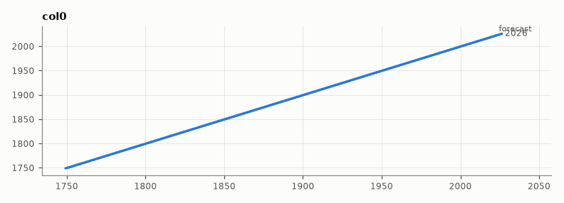
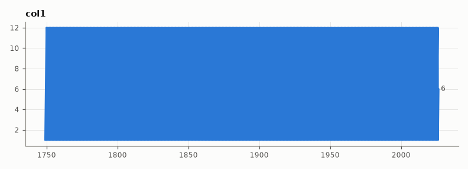
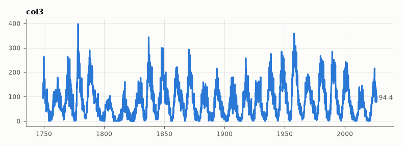
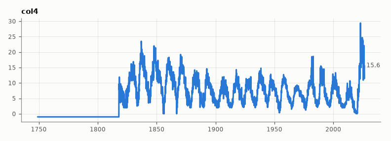
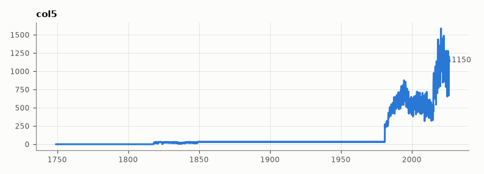
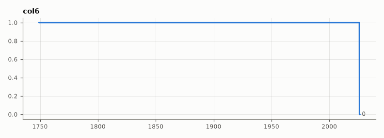

# Data report — sunspots
*2026-07-28 · 3330 rows · 7 columns · engine time 22s*

## What we found (plain English)

- **col0** — found a pattern explaining 100% of the movement (trend 100%, cycle 0%, unexplained 0%); a repeating cycle (period 1.008 (shape refused past the null)); forecast for the next 12 steps: 2026.035 .. 2026.959 (last seen 2026.0); the fitted rule, readable, is `+1.00*x0 +1748.55`.
- **col1** — found a repeating cycle (period 1.008, profile swing 0.8188), but no overall trend passed our checks — on the trend we say so rather than guess (receipt below).
- **col3** — no reliable pattern passed our checks. We say so rather than guess; the refusal receipt is below.
- **col4** — no reliable pattern passed our checks. We say so rather than guess; the refusal receipt is below.
- **col5** — found a repeating cycle (period 1.0086, profile swing 31.2579), but no overall trend passed our checks — on the trend we say so rather than guess (receipt below).
- **col6** — no reliable pattern passed our checks. We say so rather than guess; the refusal receipt is below.
- **Data quality** — audit verdict NO RULE; 0 error / 0 news / 0 duplicate / 3330 unvalidatable / 0 unflagged.

> Every claim above traces to a receipt at the bottom of this report. Where evidence was insufficient, the analysis says **NO RULE** instead of guessing — that honesty is the product.

## What we did to your file first (receipted)

- delimiter detected: ';' (converted to comma)
- no header row found — generated column names

## Charts








## The receipts — analyst face (verbatim)

```
THE ANALYST'S REPORT — sunspots.normalized.csv
  3330 rows; time key: col2 (auto: 'col2' strictly increases)
    col0: 1749.0 .. 2026.0
    col1: 1.0 .. 12.0
    col2: 1749.042 .. 2026.453
    col3: 0.0 .. 398.2
    col4: -1.0 .. 29.4
    col5: -1.0 .. 1587.0
    col6: 0.0 .. 1.0
  ── col0 ──
    trend [UNDERSTOOD]: +1.00*x0 +1748.55
    cycle: period 1.008 (shape refused past the null)
    the books: trend 100.0% + seasonal 0.0% + residual 0.0% = 100
    receipt: profile: explains -0.02 <= null 0.01 — period said, shape refused
    forecast next 12: 2026.035 .. 2026.959 (last seen 2026.0)
    watch: BASELINE (err_norm 0.000144) — arriving data will be judged
  ── col1 ──
    trend [NO RULE]: NO RULE (nothing beat the null)
    cycle: period 1.008, profile swing 0.8188
    the books: trend 0.0% + seasonal 0.6% + residual 99.4% = 100
    receipt: trend: NO RULE — flat (mean) stands, said
    forecast next 12: -0.4328 .. 0.386 (last seen 6.0)
    watch: BASELINE (err_norm 0.988972) — arriving data will be judged
  ── col3 ──
    trend [NO RULE]: NO RULE (nothing beat the null)
    the books: trend -0.0% + seasonal 0.0% + residual 100.0% = 100
    receipt: period: best autocorr 0.07 <= null 0.08 — no cycle said
    receipt: trend: NO RULE — flat (mean) stands, said
    forecast next 12: 0.0 .. 0.0 (last seen 94.4)
    watch: BASELINE (err_norm 1.0) — arriving data will be judged
  ── col4 ──
    trend [NO RULE]: +0.00*exp(0.39*x0) +0.00
    the books: trend -0.0% + seasonal 0.0% + residual 100.0% = 100
    receipt: period: best autocorr 0.07 <= null 0.08 — no cycle said
    receipt: trend: NO RULE — flat (mean) stands, said
    forecast next 12: 0.0 .. 0.0 (last seen 15.6)
    watch: BASELINE (err_norm 1.0) — arriving data will be judged
  ── col5 ──
    trend [NO RULE]: +23.98*[x0>70] +7.13*[x0>105] -0.77
    cycle: period 1.0086, profile swing 31.2579
    the books: trend 0.0% + seasonal 0.1% + residual 99.9% = 100
    receipt: trend: NO RULE — flat (mean) stands, said
    anomalies: 5 flagged (worst 5.4x at t=2020.624) — flagged beyond 4x residual rms — named, never judged
    forecast next 12: -17.0394 .. 14.2185 (last seen 1150.0)
    watch: BASELINE (err_norm 0.998878) — arriving data will be judged
  ── col6 ──
    trend [NO RULE]: NO RULE (nothing beat the null)
    the books: trend 0.0% + seasonal 0.0% + residual 100.0% = 100
    receipt: period: best autocorr 0.00 <= null 0.00 — no cycle said
    receipt: trend: NO RULE — flat (mean) stands, said
    forecast next 12: 0.0 .. 0.0 (last seen 0.0)
    watch: BASELINE (err_norm 1.0) — arriving data will be judged
  ── relations ──
    col0 ~ col1: RELATED corr -1.0 vs null 0.949 (same-step); levels -0.003 — levels co-move trivially under shared trends — reported, never judged
    col0 ~ col6: RELATED corr -0.058 vs null 0.058 (same-step); levels -0.074 — levels co-move trivially under shared trends — reported, never judged
    col3 ~ col4: RELATED corr 0.706 vs null 0.072 (same-step); levels 0.518 — levels co-move trivially under shared trends — reported, never judged
    col5 ~ col6: RELATED corr -0.202 vs null 0.049 (b leads by 2); levels -0.143 — levels co-move trivially under shared trends — reported, never judged
    refused pairs: 11 (the null was not beaten — receipts kept)
  ── the dossier (node dossier:sunspots.normalized) ──
    col0: n 3330, mean 1887.25, median 1887, std 80.1196
      mode 1749 (x12, 277 tied); resolution 1; lo 1749 / hi 2026 (rows kept)
    col1: n 3330, mean 6.49459, median 6, std 3.45257
      mode 1 (x278, 6 tied); resolution 1; lo 1 / hi 12 (rows kept)
    col3: n 3330, mean 82.2045, median 68.55, std 67.5862
      mode 0 (x67); resolution 0.1; lo 0 / hi 398.2 (rows kept)
    col4: n 3330, mean 5.75733, median 5.4, std 5.42659
      mode -1 (x828); resolution 0.1; lo -1 / hi 29.4 (rows kept)
    col5: n 3330, mean 125.285, median 30, std 263.492
      mode 31 (x943); resolution 1; lo -1 / hi 1587 (rows kept)
    col6: n 3330, mean 0.998198, median 1, std 0.0424157
      mode 1 (x3324); resolution: none read; lo 0 / hi 1 (rows kept)
    examples: 19 rows remembered of 3330 (extremes + even spread by outcome rank (the facts-layer sampler, reused))
    frames: no calendar time (none told, none derivable — a year-band column also needs a calendar-sounding name) — frames refused; the stats stand
    ratio col0/col1: mean 488.591 (145.75 .. 2026)
    ratio col0/col3: refused — denominator crosses or touches zero — a ratio there is a lie waiting
    ratio col0/col4: refused — denominator crosses or touches zero — a ratio there is a lie waiting
    ratio col0/col5: refused — denominator crosses or touches zero — a ratio there is a lie waiting
    ratio col0/col6: refused — denominator crosses or touches zero — a ratio there is a lie waiting
    ratio col1/col3: refused — denominator crosses or touches zero — a ratio there is a lie waiting
    ratio col1/col4: refused — denominator crosses or touches zero — a ratio there is a lie waiting
    ratio col1/col5: refused — denominator crosses or touches zero — a ratio there is a lie waiting
    ratio col1/col6: refused — denominator crosses or touches zero — a ratio there is a lie waiting
    ratio col3/col4: refused — denominator crosses or touches zero — a ratio there is a lie waiting
    ratio col3/col5: refused — denominator crosses or touches zero — a ratio there is a lie waiting
    ratio col3/col6: refused — denominator crosses or touches zero — a ratio there is a lie waiting
    ratio col4/col5: refused — denominator crosses or touches zero — a ratio there is a lie waiting
    ratio col4/col6: refused — denominator crosses or touches zero — a ratio there is a lie waiting
    ratio col5/col6: refused — denominator crosses or touches zero — a ratio there is a lie waiting
```

## The receipts — audit face (verbatim)

```
ISAAC — the audit
============================================================

TABLE sunspots.normalized.csv   target: col6   rows: 3330
  VERDICT: NO RULE
    col6 = NO RULE (nothing beat the null)
  floor[col6]: UNEVIDENCED — ASK for the instrument's resolution
  floor[col0]: 0.288675 via grain
  floor[col1]: 0.288675 via grain
  floor[col2]: 0.0242487 via grain
  floor[col3]: 0.0288675 via grain
  floor[col4]: 0.0288675 via grain
  floor[col5]: 0.288675 via grain
  flags: refused (no applicable law — rows counted unvalidatable, never silently passed)
  counts: 0 error / 0 news / 0 duplicate / 3330 unvalidatable / 0 unflagged

ASK: the instrument's resolution for: col6  (rerun with --resolution col=sigma)

COMPLETE NUMBERS
  1 tables, 3330 rows audited; 0 error / 0 news / 0 duplicate flags; 3330 unvalidatable; 0 laws; 1 flag refusals; asks: col6

[8 records -> audit.jsonl]
```