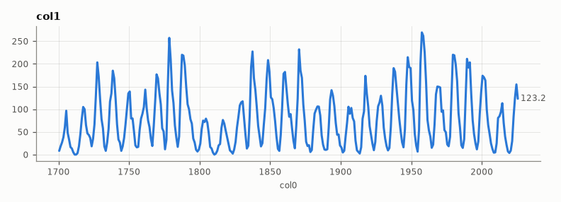
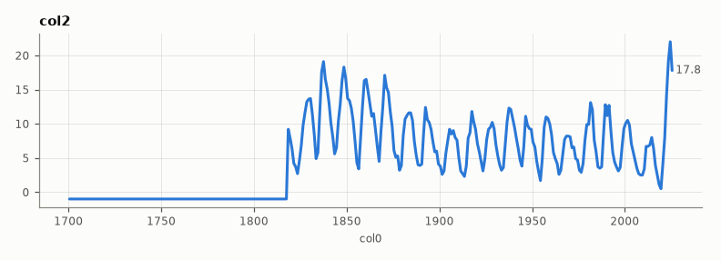
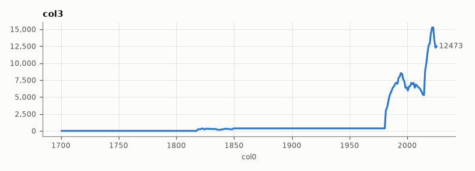
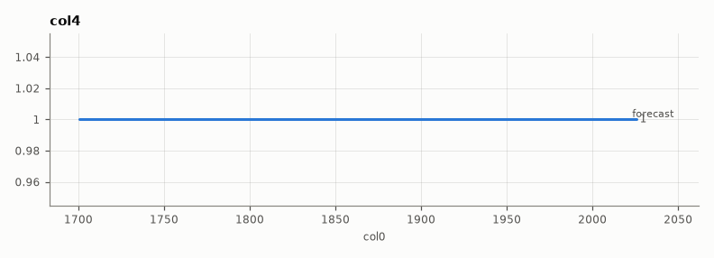

# Data report — sunspots_yearly
*2026-07-29 · 326 rows · 5 columns · engine time 2s*

## The headlines

- col1 and col2 move together (r=+0.47) — SOLID
- ↳ useful for sanity-checking a forecast of one from the other; it does not say which causes which


## Column by column (plain English)

- **col1** — found a repeating cycle (period 10.4534, profile swing 60.6014); no law-grade trend certified. what's there: rising +0.07799 per unit col0 (about +25.35 across the whole record) — WEAK: direction held in 99% of 200 random half-samples, in both the early and late halves; half-sample spread [+0.01249, +0.1543] per unit col0. Caution: values follow each other strongly here (persistence 0.82), and drifts like this can appear in wandering data — after accounting for that, the direction is not dependable
- **col2** — found a repeating cycle (period 10.7285, profile swing 3.7814); no law-grade trend certified. what's there: rising +0.03372 per unit col0 (about +10.96 across the whole record) — WEAK: direction held in 100% of 200 random half-samples, NOT in both the early and late halves; half-sample spread [+0.02987, +0.03779] per unit col0
- **col3** — found a repeating cycle (period 34.0074, profile swing 694.1504); no law-grade trend certified. what's there: rising +18.55 per unit col0 (about +6028 across the whole record) — WEAK: direction held in 100% of 200 random half-samples, in both the early and late halves; half-sample spread [+14.62, +22.45] per unit col0. Caution: values follow each other strongly here (persistence 0.99), and drifts like this can appear in wandering data — after accounting for that, the direction is not dependable
- **col4** — found a pattern explaining 100% of the movement (trend 100%, cycle 0%, unexplained 0%); forecast for the next 12 steps: 1.0 .. 1.0 (last seen 1.0); the fitted rule, readable, is `-0.00*x0 +1.00`.
- **Data quality** — audit verdict UNDERSTOOD; 0 error / 0 news / 0 duplicate / 0 unvalidatable / 326 unflagged.

> Two kinds of claims above, kept honest: a **certified rule** passed our strictest checks; a **what's-there** description reports the plain trend graded by whether it survives 200 random half-samples (SOLID / WEAK / UNSTABLE) — described, never certified. Every claim traces to a receipt at the bottom; where we can't stand behind a number at all, we say so instead of guessing.

## What we did to your file first (receipted)

- delimiter detected: ';' (converted to comma)
- no header row found — generated column names

## What is in this data

- **col0** (number): 326 values, 1,700 to 2,026, typical 1,863, mean 1,863, total 607,338
- **col1** (number): 326 values, 0 to 269, typical 66.2, mean 78.9, total 25,720
- **col2** (number): 326 values, -1 to 22, typical 4.2, mean 4.8, total 1,565
- **col3** (number): 326 values, -1 to 15,258, typical 365, mean 1,263, total 411,844
- **col4** (number): 326 values, 1 to 1, typical 1, mean 1, total 326

## What moves together

- **col1 and col2** move together (r=+0.47) — SOLID (sign held in 100% of half-samples, spread [+0.38, +0.57]); still r=+0.50 with the shared time-trend removed. Link, not cause — we can't say which drives which from this table alone.

## Where the weight sits

- **col0**: top 20% of rows carry 21% of the total — fairly evenly spread.
- **col1**: top 20% of rows carry 45% of the total — fairly evenly spread.
- **col4**: top 20% of rows carry 20% of the total — fairly evenly spread.


## Charts






## The receipts — analyst face (verbatim)

```
THE ANALYST'S REPORT — sunspots_yearly.normalized.csv
  326 rows; time key: col0 (auto: 'col0' strictly increases)
    col0: 1700.5 .. 2025.5
    col1: 0.0 .. 269.3
    col2: -1.0 .. 22.0
    col3: -1.0 .. 15258.0
    col4: 1.0 .. 1.0
  ── col1 ──
    trend [NO RULE]: NO RULE (nothing beat the null)
    cycle: period 10.4534, profile swing 60.6014
    the books: trend -0.0% + seasonal 12.0% + residual 88.0% = 100
    receipt: trend: NO RULE — flat (mean) stands, said
    forecast next 12: -25.1844 .. 35.417 (last seen 123.2)
    watch: BASELINE (err_norm 0.983928) — arriving data will be judged
  ── col2 ──
    trend [NO RULE]: +0.00*exp(0.24*x0) -1.00
    cycle: period 10.7285, profile swing 3.7814
    the books: trend 0.0% + seasonal 6.9% + residual 93.1% = 100
    receipt: trend: NO RULE — flat (mean) stands, said
    forecast next 12: -1.8962 .. 1.8852 (last seen 17.8)
    watch: BASELINE (err_norm 0.946951) — arriving data will be judged
  ── col3 ──
    trend [NO RULE]: +310.05*cos(0.1795*x0) +0.00*exp(0.25*x0) -0.00*exp(0.3*x0)*sin(0.1848*x0) +1.51
    cycle: period 34.0074, profile swing 694.1504
    the books: trend 0.0% + seasonal 1.5% + residual 98.5% = 100
    receipt: trend: NO RULE — flat (mean) stands, said
    anomalies: 5 flagged (worst 4.8x at t=2022.5) — flagged beyond 4x residual rms — named, never judged
    forecast next 12: -84.8595 .. 327.2761 (last seen 12473.0)
    watch: BASELINE (err_norm 0.995781) — arriving data will be judged
  ── col4 ──
    trend [UNDERSTOOD]: -0.00*x0 +1.00
    the books: trend 100.0% + seasonal 0.0% + residual 0.0% = 100
    forecast next 12: 1.0 .. 1.0 (last seen 1.0)
    watch: BASELINE (err_norm 0.0) — arriving data will be judged
  ── relations ──
    col1 ~ col2: RELATED corr 0.7 vs null 0.365 (same-step); levels 0.47 — levels co-move trivially under shared trends — reported, never judged
    col1 ~ col3: RELATED corr -0.158 vs null 0.137 (same-step); levels -0.016 — levels co-move trivially under shared trends — reported, never judged
    refused pairs: 4 (the null was not beaten — receipts kept)
  ── the dossier (node dossier:sunspots_yearly.normalized) ──
    col1: n 326, mean 78.8963, median 66.25, std 61.9203
      mode 18.3 (x5); resolution 0.1; lo 0 / hi 269.3 (rows kept)
    col2: n 326, mean 4.80123, median 4.2, std 5.46321
      mode -1 (x118); resolution 0.1; lo -1 / hi 22 (rows kept)
    col3: n 326, mean 1263.33, median 365, std 2894.19
      mode -1 (x118); resolution 1; lo -1 / hi 15258 (rows kept)
    col4: n 326, mean 1, median 1, std 0
      mode 1 (x326); resolution: none read; lo 1 / hi 1 (rows kept)
    examples: 16 rows remembered of 326 (extremes + even spread by outcome rank (the facts-layer sampler, reused))
    frames: no calendar time (none told, none derivable — a year-band column also needs a calendar-sounding name) — frames refused; the stats stand
    ratio col1/col2: refused — denominator crosses or touches zero — a ratio there is a lie waiting
    ratio col1/col3: refused — denominator crosses or touches zero — a ratio there is a lie waiting
    ratio col1/col4: mean 78.8963 (0 .. 269.3)
    ratio col2/col3: refused — denominator crosses or touches zero — a ratio there is a lie waiting
    ratio col2/col4: mean 4.80123 (-1 .. 22)
    ratio col3/col4: mean 1263.33 (-1 .. 15258)
```

## The receipts — audit face (verbatim)

```
ISAAC — the audit
============================================================

TABLE sunspots_yearly.normalized.csv   target: col4   rows: 326
  VERDICT: UNDERSTOOD
    col4 = -0.00*cos(0.5*col1) +1.00
  floor[col4]: UNEVIDENCED — ASK for the instrument's resolution
  floor[col0]: 0.288675 via grain
  floor[col1]: 0.0288675 via grain
  floor[col2]: 0.0288675 via grain
  floor[col3]: 0.288675 via grain
  flags: refused (target floor UNEVIDENCED — ASK for the instrument's resolution; no ruler, no flags)
  counts: 0 error / 0 news / 0 duplicate / 0 unvalidatable / 326 unflagged

ASK: the instrument's resolution for: col4  (rerun with --resolution col=sigma)

COMPLETE NUMBERS
  1 tables, 326 rows audited; 0 error / 0 news / 0 duplicate flags; 0 unvalidatable; 1 laws; 1 flag refusals; asks: col4

[6 records -> audit.jsonl]
```